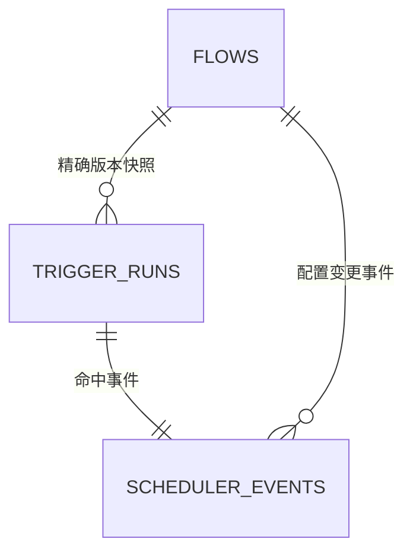

# ADR 0103：Flow 定时触发与事件驱动调度模块

## 状态

2026-09-20：源码集成、调度表及领取/恢复的实现选择由 [ADR 0107](0107-integrate-postgresql-trigger-scheduling.md) 取代；下文保留原决策记录。

Accepted：用户已确认 Flow 自有独立 Trigger、AbstractTrigger、首期定时、源码集成
 db-scheduler 和事件驱动。以下运行默认值是本次实现选择。

## 背景

一个 Flow 可以有多个独立触发器，每个条件满足都产生一个新的 Execution。
触发定义随正式版本保存；运行中的游标、重试和投递状态不能写回定义。

参考本地 Kestra `scheduler` 的 `TriggerEventHandler`、`TriggerScheduler` 与
`internals/NextEvaluationDate`：定义、可变调度状态和触发事件分离，通过事件刷新
状态并启动执行。只借鉴职责划分，不复制 Kestra 源码。本期不实现其 Worker Trigger、
条件组合、分片、回填和依赖执行结束的并发限制。

## 备选方案

- 进程内计时器：重启丢失计划，多实例重复命中。
- 依赖 db-scheduler JAR：满足调度但不符合用户的源码集成要求。
- 完整搬入 Kestra scheduler：依赖其运行时、状态和分片体系，超出定时需求。
- 独立 scheduler 模块纳入 db-scheduler 核心源码，复用现有 Flow/Pulsar：采用。

## 决策

### 模块与定义

依赖为 `server → scheduler → core → gen`，Core 不反向依赖 scheduler。
`core/domains/triggers/Trigger` 是插件契约，`AbstractTrigger` 保存 id、key、说明、
disabled、inputs；`extensions/triggers/ScheduleTrigger` 增加 cron、timezone。
共享 SchedulerEvent 协议放在 Core 模块的 `org.cses.flow.scheduler.events`，
不属于可变领域模型。Entry 调用同级 codec 处理 JSON。

2026-09-16 按用户确认的 Kestra 职责划分收拢启动入口：scheduler 管理定时计划、
配置同步、命中事实与 outbox 生命周期；Core 模块中的 TriggerExecutionPublisher
统一核验命中快照、恢复操作者上下文、调用 ExecutionService.create 并记录受理。
FlowScheduler 仅将命中事件交给该入口，不再直接依赖 ExecutionService 或 SessionFactory。
发布器不启动定时器，不依赖 scheduler 模块或 db-scheduler；Executor 继续负责实例
物化与运行推进。保留一个具体发布器，不增加单实现接口。
调度器在 Micronaut ShutdownEvent 阶段停止并等待回调退出，早于 Bean 资源销毁，
防止 outbox 在 Pulsar 客户端关闭后仍尝试发布；PreDestroy 保留幂等停止兜底。
插件目录和 Schema 暴露 triggers，源定义不能指定系统 id，同 key 发布沿用 id。
Flow.triggers 保存定义；保存草稿不启用调度。本期草稿和正式版本均校验触发器
结构、Cron 与时区，正式发布时再校验启动输入与 Flow 声明的匹配。

首期使用 SPRING53 六段 Cron（秒 分 时 日 月 周），必须显式给出 IANA 时区。
最新正式版本控制未来命中；禁用、移除或删除 Flow 停止未来计划；已经持久化的命中
按原版本和参数继续投递。变更与到期交错时，以到期回调读取的正式版本作为本次
选择点。多个触发器独立，可同时启动，也允许同一 Flow 的 Execution 重叠。
配置事件异步生效：首次创建或更改 Cron 时，从配置处理时刻之后计算下一次；
如果生效前目标时间已过去，不追补这次尚未登记的计划。重启保留数据库当前未处理的
一次计划，处理后从当前
时间计算下一次；不逐条追补停机期间全部周期。时区和 DST 运算由固定版本 cron-utils
执行，不能承诺不存在的当地时间也会运行。

### 数据事实与规范化

| 表 | 主键 / 唯一性 | 职责 |
| --- | --- | --- |
| flows.triggers | 既有公司、Flow key、版本行中的 JSON 数组 | 随版本不可变的多态定义 |
| scheduled_tasks | 上游 task_name + task_instance | 下一次时间、领取 CAS、心跳与重试数据 |
| trigger_runs | company_id + id；公司 + execution_id；公司 + Flow key + trigger_key + scheduled_at 唯一 | 一次命中的固定版本、输入、操作者及预分配实例 ID |
| scheduler_events | company_id + id；待发布部分索引 | 持久化 outbox、投递重试和 Broker 受理事实 |

图中的关系为逻辑关联；沿用追加版本模型，不增加跨快照外键或级联删除。
定义 JSON 属于 Flow 值对象，避免第二套可独立修改的触发器配置；trigger_runs 中
inputs 是命中时绑定后的事实，而非需要随 Flow 更新的冗余数据。
accepted_at 仅表示 Executor 命令队列已受理，运行结果由 Execution 查询提供。
应用时间均为 bigint 毫秒；上游 scheduled_tasks 保持 timestamp with time zone 和 bytea
协议，仅允许在第三方调度基础设施使用。上游表单独放在 scheduler/sql，不纳入 JOOQ
生成；应用表放 gen/sql/flow/tables，由现有生成器生成，不手写生成类。

### 事件与恢复

1. 正式 Flow 行、Task 快照和 FLOW_CHANGED outbox 在同一条数据修改 CTE 中提交。
2. 持久化的 outbox 任务发送事件，Broker 受理后更新 published_at；失败保存重试时间。
3. 配置消费者读取最新正式版本，同一公司/Flow 的并发同步通过短期数据库 advisory
   lock 串行处理，旧事件不会重新启用历史配置。db-scheduler 负责计划领取与 CAS。
4. 到期回调再次检查最新定义和触发器身份。ScheduleData 在入队前持久化这次计划的
   scheduledAt、eventId、executionId，失败重试和失活节点恢复不重新分配身份。
5. 命中记录和 TRIGGER_FIRED outbox 以一条 CTE 原子写入，只有首次插入命中记录才
   写事件；随后推进调度游标。若在两步之间崩溃，重试同一坐标并受唯一约束保护。
   不增加事务 DataSource 包装器，也不要求业务事务跨越 Broker。
6. scheduler 命中消费者调用 Core 的 TriggerExecutionPublisher；发布器校验事件
   与持久化记录，使用固定版本、输入和 executionId 调用现有
   ExecutionService.create，再由原 Create → Executor → Worker 链路执行。
   受理后丢失 ACK 时重复 Create 仍沿用同一个实例 ID。

上述数据库事务和 advisory lock 只协调调度基础设施，属于 ADR 0084 业务聚合无事务
规则的明确局部边界。Flow/Execution 的普通命令处理和快照保存不引入锁定读取。

### 上游源码与分发

`scheduler/src/upstream/java` 固定 db-scheduler v16.11.0，提交
`8c3e465d5651f9fcad673ab54863932259b5de64`。保留原包名、版权头和 Apache-2.0 许可。
来源和省略项见 scheduler/UPSTREAM.md。只省略未用的可选 Gson/Jackson 和 Micrometer
适配器；实际调度数据采用 PAAS JSON。许可证与来源随 JAR 一并分发。
第三方源码保持上游编码、java.time、JDBC 和技术身份规则，不按本项目 Java 风格改写；
自有适配仅位于 scheduler/src/main/java。源码纳入本模块编译，构建没有 db-scheduler
发布制品依赖。新增 scheduler Maven 模块，修订 ADR 0100 的三模块发布集合。

## 理由

复用成熟的数据库领取、心跳和失败恢复；用稳定事实和唯一约束封闭跨事务重复窗口，
复用现有队列及启动入口。保留可追溯源码，避免引入与 Flow 平行的执行引擎。

## 后果

- 调度保证可重投递及实例身份幂等，不承诺外部任务副作用的 exactly-once。
- outbox 和 trigger_runs 当前保留历史；没有自动清理。上线容量治理需明确审计保留期后
  再增清理策略，不能提前删除仍可能恢复投递的命中事实。
- 首期配置同步会扫描该调度任务类型，规模增长后增加租户/Flow 的索引投影。
- 需应用数据库基线和 scheduler/sql/scheduled_tasks.sql 后再启用模块；缺表启动失败。
- 本期不提供 Webhook、事件条件、固定间隔或一次性时间类型；以后按独立 Trigger 扩展。
- 验收看 UC-14 与 Test Agent 的实际报告；本 ADR 本身不是验证通过证据。
