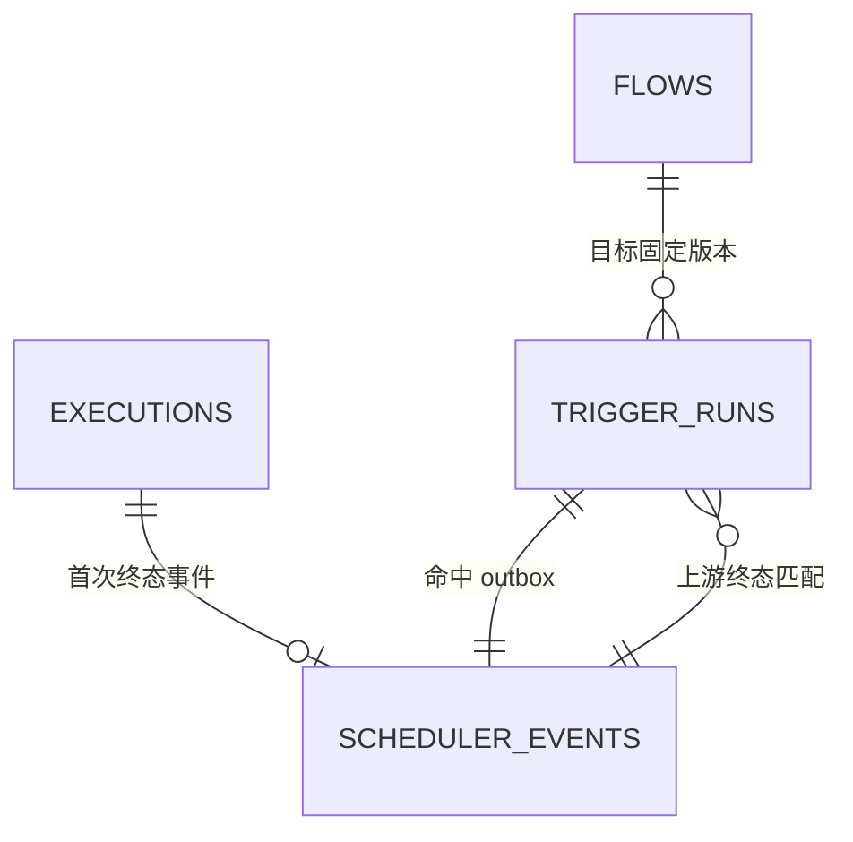

# ADR 0104：流程、Webhook 与指定日期触发

## 状态

Accepted：用户确认暂不实现 EventTrigger，先落地 FlowTrigger、WebhookTrigger、ScheduleOnDatesTrigger。
以下认证、终态集合、过期和循环处理是本期明确的实现默认值。UC-15、16、17只描述已确认基础场景。

## 背景

ADR 0103 的执行启动已移到 Core，但命中 outbox 的发布与消费仍依赖定时器，且去重只接受计划时间。
新来源必须共享持久化启动链路，不能用事件接收时间伪装计划身份。参考 Kestra 的分类能力与分离入口，
不引入完整 Worker polling/realtime、MCP、EventBus、多上游窗口或匿名 Webhook。

## 备选方案

- 每类触发器独立实现启动与重试：重复协议，拒绝。
- 全部交给 db-scheduler：HTTP 和上游终态没有定时计划，拒绝。
- 分类入口，统一持久化命中与启动：采用。

## 决策

### 职责

- Trigger/AbstractTrigger 保留公共定义；ScheduledTrigger 增加 nextAt(long) 与 scheduleKey()，
  由 Cron 和日期列表两个具体类型实现。日期均为 UTC Unix 毫秒，Cron 保留显式时区。
- scheduler 模块只注册、刷新、取消时间计划，领取到点任务并向 Core TriggerRuntime 保存命中。
- Core TriggerRuntime 独立执行 outbox 发布与命中消费，不受 flow.scheduler.enabled 控制。
  其 ShutdownEvent 处理先等待当前发布结束，再允许容器销毁消息资源。
- Core TriggerExecutionPublisher 继续核验持久化快照，通过 ExecutionService 发布 Create。
- Server WebhookTriggerController 只绑定认证会话、请求参数和 HTTP 响应。
- FlowTrigger 由原子保存的上游终态事件驱动，不读取数据库变更流，也不引入通用业务 EventBus。

### 类型行为

ScheduleOnDatesTrigger：dates 为非空、非负、不重复的 UTC 毫秒列表。顺序不影响计划。
初次生效只安排当前时间之后的日期；耗尽后不再注册任务。重启后保留数据库中的一条过期计划，
处理后安排当前时间之后的下一个日期，不补跑全部错过时间；与既有 Cron 策略一致。

FlowTrigger：flowKey 为同租户上游名称，states 默认 [SUCCESS]，支持 SUCCESS、FAILED、KILLED。
每个上游 Execution 的首次终态通知只处理一次，匹配当时最新正式目标定义。每个匹配触发器独立启动，
固定目标版本与静态 inputs。没有匹配项也标记已处理；重复通知不匹配后来发布的新目标。
按持久化 trigger_runs 来源链排除已经过的 Flow key，阻止直接自触发及 A→B→A 触发循环；
不实现多上游组合、暂停态、上游输出动态映射。不同上游实例独立触发。

WebhookTrigger：沿用 PAAS/AuthX 已认证且选择公司的 @UserSession，目标租户只从会话获取。
POST /triggers/flows/{flowKey}/{triggerKey}，JSON body 直接为 Flow inputs，必填 Idempotency-Key（最多128字符）。
body 只能补充输入，不能覆盖触发器静态 inputs。发布配置允许请求在运行时补齐必填项，
已配置的静态项仍校验名称和类型。首次请求固定 Flow 版本与规范化输入，返回 202 和 executionId；
202表示可靠接收，不表示执行完成。同一操作者、公司、Flow、trigger key、请求键复用同一实例；
重复请求按原版本重新规范化并比较输入，不一致拒绝。已经受理的请求在后续禁用或删除后仍可取得原回执。
未知流程、错误触发类型、禁用、新请求输入错误均拒绝；不暴露匿名秘钥 URL。

### 数据与恢复

关系为逻辑关联，不增加数据库外键。执行快照及首次 FLOW_TERMINATED outbox 以同一 CTE 提交，
只有成功的根 CAS 才能写通知；通知 ID 沿用上游 executionId，重复终态保存不生成新通知。

trigger_runs 新增 source_key，唯一性为 company_id + flow_key + trigger_key + source_key：

- schedule:<scheduledAt>：时间型来源。
- flow:<upstreamExecutionId>：上游执行来源。
- webhook:<actorId长度>:<actorId>:<requestId>：HTTP 请求来源。

scheduled_at 仅时间型有值，不用假时间填充其他来源。已有 execution_id 唯一约束保留。
SchedulerEvent 携带 sourceKey，Entry/Codec 仍负责映射。scheduler_events 新增 processed_at，
用于上游通知处理完成事实，与 Broker 投递受理的 published_at 含义不同。

上游匹配使用通知行短事务锁；完整匹配集合、命中与命中 outbox、processed_at 同次提交，
防止部分匹配后重投改变接收者。Webhook 使用公司/流程/触发器/请求键范围的短 advisory lock，
命中与 outbox 原子保存。以上是触发基础设施的局部一致性边界，沿用 ADR0103 对 ADR0084 的例外；
不改变 Flow/Execution 普通领域命令的无跨调用事务模式。

## 理由

各来源拥有自己的时间或事件身份，启动、去重与投递只有一套实现；关闭定时扫描不阻断其他来源。
保留现有 Queue/Create/Executor/Worker 链路，不创建第二套执行引擎。

## 后果

- 开发期基线改变，必须在隔离开发库重建并重新生成 JOOQ。未升级业务数据库。
- 原 scheduled_tasks 载荷从 cron/timezone 改为 schedule 规则比较值，开发库重建时一并清空；不保留旧载荷兼容分支。
- Core 开始发布自身持久化触发 outbox；不应再用 flow.scheduler.enabled 暂停全部触发。
- 同租户目标 Flow 暂时逐个读取；数量增长后增加按上游 key 过滤的索引投影。
- outbox/命中历史仍需后续制定保留策略，不能提前清理可能重试的来源事实。
- 保证稳定实例身份与可重投递，不承诺外部任务副作用 exactly-once。
- 验收以本次测试报告为准，声明插件与编译成功不等于功能验收。
