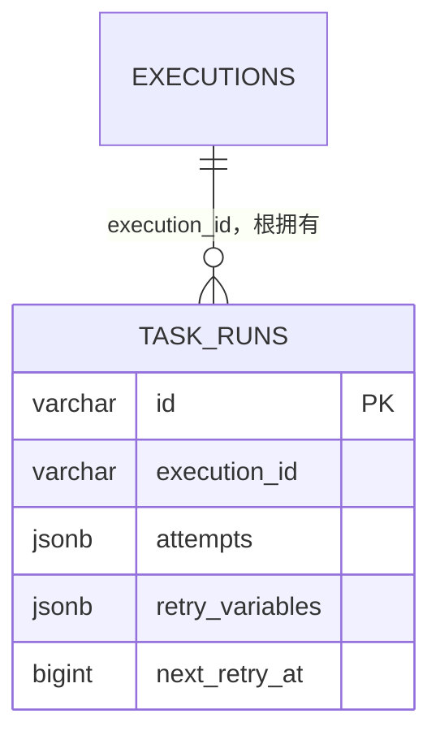

# ADR 0105：可扩展任务重试与持久化到期调度

## 状态
Accepted（2026-09-17）。到期扫描机制已于 2026-09-20 被 [ADR 0106](0106-use-pulsar-delayed-task-retries.md) 替代；策略、Attempt 与失败语义保持。

## 背景与备选
Task 失败当前立即传播到 Execution。参考本地 Kestra 3008271230 的策略多态、尝试历史和 Executor 到期重新调度。
Worker 内等待重跑不能恢复；独立登记定时计划增加双写窗口；采用 TaskRun 保存到期事实、Executor 重复查询和唤醒。

## 决策
- RunnableTask 显式 retry，constant/exponential/random 共享次数、预算与 warningOnRetry。
  maxAttempts 必填且包含首次，未配置不重试。次数至少 1；预算正毫秒，控制下一次开始时间，不中断当前调用。
  固定间隔允许 0；指数间隔正数、倍率有限且至少 1，封顶；随机范围左闭右开。
- 策略子类计算间隔；Jackson 原生具名多态可通过子类与注册扩展，Executor 不判断类型。
- TaskRun 保持身份与循环轮次；attempts 保存 Runnable 调用事实，retryVariables 保存首次调用变量快照，nextRetryAt 保存到期时间。
  下一次调用复用首次业务变量，仅更新 taskRun.attemptNumber；Task 定义不得依赖可变实例字段承载调用状态。
- RUNNING -> RETRY_WAIT -> CREATED -> RUNNING；等待期间 Execution RUNNING。错误留在 Attempt，只有耗尽才使 TaskRun FAILED 并按既有规则传播。
  warningOnRetry 仅使多次尝试后成功变 WARNING。取消/失败关闭时清除等待时间。
- Executor 到期查询始终过滤 RUNNING 根，携带真实租户与 Execution 身份投递普通 UPDATED；不经过 Trigger scheduler。
  到期事实与 TaskRun、Execution 使用已有单 SQL/CAS 保存；在成功开始下一 Attempt 前保持 nextRetryAt。
  发布失败、发布后宕机和 CREATED 后宕机均可再次扫描。重复事件由 CAS 领取，迟到结果由 Attempt 编号过滤。
- 次数与错误判断归领域/Executor；Worker 仅执行一次。CAS 结果合并冲突只重做保存，不重跑 Worker。
- 范围不包括 errors/allowFailure/finally、新 Execution 重试、父级或 Flow 默认策略、编排整体重跑、失联 Worker 回收。
  外部副作用仍需以 taskRunId 做业务幂等；不承诺 exactly-once。
- 与既有 replay 的交接保护一致，存在运行中的 Worker 或待重试节点时等待其收敛，防止把仅在来源实例登记的重试计划复制到派生实例。
- TaskRunValuesJsonCodec 的 encodeVariables 按 PAAS 树节点写入重试变量，完整保留空 Map、空 List 和 null，避免全局 NON_EMPTY 配置破坏重试变量路径。
  既有任务输入输出继续使用 encode，不改变原有省略空值的持久化语义。

## 存储

关系为逻辑关联，无外键。尝试历史和调用快照没有独立生命周期，内嵌 JSONB；到期时间需要范围扫描，使用独立 bigint 与部分索引。

## 理由与后果
无新增依赖、独立业务表或 Trigger 耦合。到期查询批量有界；实际开始时间可能晚于计划，因此唤醒与实际领取时都检查预算。
修改开发期基线并从临时空库重新生成 JOOQ；旧开发库须按手册重建，不提供运行期迁移。
