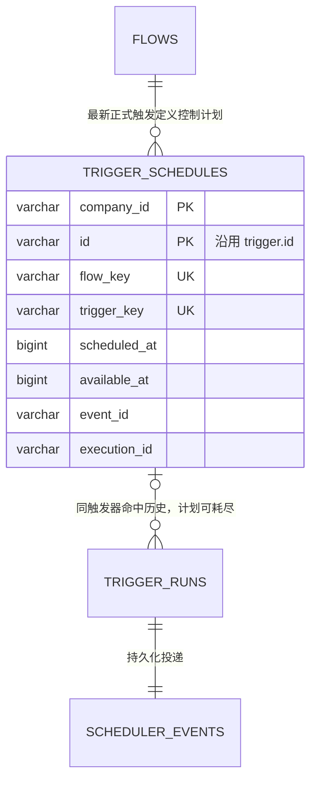

# ADR 0107：将 PostgreSQL 调度能力融入 Flow

## 状态

Accepted：2026-09-20 用户要求将实际使用的 db-scheduler 能力融入项目，并确认只保留
Flow 所需的 PostgreSQL 能力。到期回调只写同一个数据库，采用短事务完成领取、命中
与计划推进，不保留通用任务 API、多数据库方言、心跳线程或租约层。
本决策取代 ADR 0103 中整包上游源码、独立上游表和跨事务推进游标的实现选择。

## 背景

原实现将 146 个上游 Java 文件纳入编译，Flow 仅使用一种任务：读取当前正式触发
定义，写入 trigger_runs 和 scheduler_events，再计算下一次时间。通用任务回调、
多数据库方言、任务序列化器、任务注册表和可插拔统计层没有项目调用方。

db-scheduler 的持久化领取与重试机制需要保留，但执行回调不包含外部业务调用。
Core 的 outbox 发布器与 Executor 继续负责跨消息队列的流程启动；Task 重试仍走
Pulsar flow-delay，不复用这里的定时扫描。

## 备选方案

- 将整个上游包重命名：仍保留无调用方的通用框架，不能形成项目自身职责边界。
- 裁剪上游类但保留事务外任务回调：仍需持久化领取、心跳、租约恢复和完成 CAS。
- 提取 PostgreSQL 排他领取机制，命中与游标在同一短事务提交：采用。

## 决策

### 模块边界

保留 `server → scheduler → core → gen`。Scheduler 内只有 FlowScheduler、计划坐标
ScheduleData，以及 ScheduleRepository / ScheduleEntry；不再编译 src/upstream，
不再使用 com.github.kagkarlsson API。ScheduleRepository 借鉴上游 PostgreSQL
`FOR UPDATE SKIP LOCKED` 领取机制，改用生成的 JOOQ 表与 Entry。保留准确来源及
Apache-2.0 许可证并随二进制和源码分发。

### 持久化模型

以上为逻辑关系，不创建外键。计划删除后命中历史仍保留；flows 的追加版本并非
计划的外键父行。唯一键为 `(company_id, flow_key, trigger_key)`，主键为
`(company_id, id)`，id 沿用已有 Trigger 技术身份。计划不是新的 Flow 定义副本。

一行 trigger_schedules 表示某触发器当前等待处理的一次命中。schedule 是规范化
规则快照，用于检测配置变化；scheduled_at 是这次命中的原时间；event_id 和
execution_id 在登记时分配并在失败重试中保持不变。available_at 表示下次允许
领取的时间，初始等于 scheduled_at，失败后延后；attempts、last_failure_at、
last_error 只记录该次计划的技术失败。所有时间使用 bigint UTC 毫秒。

业务键、计划时间、身份、重试状态按列存储，不再用 bytea JSON 保存可查询字段。
due 扫描使用 available_at 索引，配置同步使用租户/Flow/Trigger 唯一键前缀。
完整基线新增 gen/sql/flow/tables/trigger_schedules.sql 并生成 JOOQ 类型；删除
scheduler/sql/scheduled_tasks.sql。遵循开发期空库重建规则，不做旧表数据迁移。

### 运行与故障恢复

1. Micronaut 启动完成后，每个 poll-interval 扫描一轮，每轮至多32个独立事务。
2. 每个事务按 available_at 领取一条到期行，`FOR UPDATE SKIP LOCKED` 跳过其他
   节点已锁定行。租户全局扫描只存在于此基础设施领取入口；回写始终包含租户和身份。
3. 读取最新正式定义。触发器已删除或禁用则删除计划；规则变更则重新计算计划。
   规则相同时，调用 TriggerRuntime.stage，在当前事务写命中和 outbox，然后更新
   下一次计划；时间耗尽则删除当前行。此事务不发送消息、不运行用户 Task。
4. 提交前失败时，命中、outbox 和计划推进一起回滚。单独记录失败并将 available_at
   延后一个 poll-interval，回写包含 event_id 防止覆盖已被其他节点推进或取消的计划。
   记录失败也失败时保持原行，下轮仍可领取。
5. 进程或连接退出由 PostgreSQL 回滚事务并释放锁，没有等待租约过期的恢复阶段。
   PostgreSQL 尚未检测到断开的连接仍可能持有锁，因此不承诺瞬时故障检测。
6. 配置同步仍以租户/Flow advisory lock 串行读取最新版本，与扫描通过计划行锁
   协调；推进采用带当前 event_id 的更新或删除，不通过 upsert 复活旧计划。
7. 应用关闭先等待本机扫描退出，再关闭数据源。重启不清理计划，继续处理数据库中
   已登记的那一次命中；之后按当前时间计算下次，不补跑停机期间所有周期。

定义发布和配置通知之间仍有异步窗口；到期事务读取的最新正式版本是本次选择点。
一旦命中事务提交，后续定义删除不撤销已接受的命中。跨 Broker 启动的至少一次投递
与稳定 executionId 去重协议保持不变。

## 理由

事务外通用回调需要心跳和租约，当前回调只进行有限的同库操作，PostgreSQL 行锁及
事务回滚已覆盖相同的排他和恢复职责。合并原先“命中提交、游标推进”两个提交点，
减少崩溃窗口，同时保留稳定身份和数据库唯一性作为重复投递保护。

## 后果

- 调度模块不提供通用 Runnable 任务执行、优先级、其他数据库或外部慢任务回调。
  若引入跨数据库或外部 I/O 回调，必须重新设计事务与持久化租约边界。
- 调度持锁期间不得做网络调用；SQL 阻塞会延迟本机这一轮扫描，其他节点仍可跳过锁行。
- 开发库必须从新完整基线重建。旧 scheduled_tasks 不会被应用自动读取、转换或删除。
- UC14/15/17 保持原用户预期；技术验证另检查真实 PostgreSQL 并发、事务故障、连接
  终止和旧计划回写防护。验证结果写入当次测试报告，不以本 ADR 代替执行证据。
