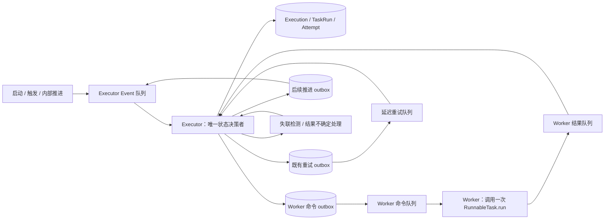
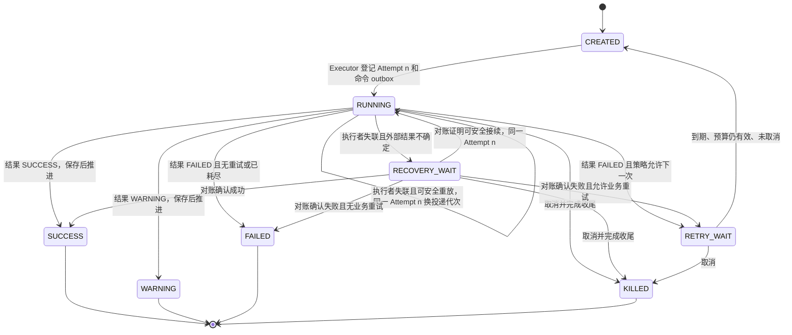

# ADR 0109：Worker 结果经队列回到 Executor 决定状态

## 状态与范围

Proposed（2026-09-23）。本文是对异步 RunnableTask 状态机的设计，尚未修改运行实现、
数据库结构或已确认 UC。它细化 [ADR 0108](0108-flow-runtime-high-availability.md)
中 RUNNING 失联恢复的方向；完整 Executor 状态机和外部域连接见
[ADR 0110](0110-model-executor-state-machine-and-domain-links.md)。正式采用后，
应修订 ADR 0059、0094 中“Executor 同步调用 Worker 并当场应用结果”的阶段性条款；
ADR 0105 的业务重试语义和
ADR 0106 的延迟队列继续有效。

## 背景

当前 `ExecutorEventMessageHandler` 保存 RUNNING 和 Attempt 后，同步调用
`WorkerDispatcher.dispatch`，拿到 `WorkerTaskResult` 再应用到聚合。TaskRun 是持久化的
运行事实，不是结果消息的发送者。UC-19 的进程崩溃验证表明，这条同步调用链在
RUNNING 已保存、Worker 尚未返回时退出后，没有领取原 RUNNING 的恢复路径。

用户提出的目标链路是：Worker 将一次调用结果投递至队列；Executor 消费结果，
依据任务配置和状态决定记录终态、进入重试、重新投递或推进流程。所有决定均从
已持久化的 Execution、精确 Flow 版本和本次 Attempt 重新计算，不依赖进程内
`ExecutorContext` 跨消息存活。

## 备选方案

1. 仅把同步返回值换成结果队列：Worker 宕机前没有发出结果时，RUNNING 仍会悬挂；
   数据库提交与命令发布之间也仍有丢消息窗口。
2. Worker 直接改写 TaskRun 状态并安排重试：形成两个状态写入者，取消与迟到结果
   竞争难以统一处理。
3. Executor 独占 Execution/TaskRun 状态迁移，命令与结果通过持久队列交接；
   在交接处加入 outbox、同次投递恢复和结果幂等判定：采用此方向。

## 架构图

图中的四条队列分别承载内部推进、Worker 命令、Worker 结果和到期重试；
结果队列不是 Executor Event 的普通 `UPDATED` 消息。结果需要精确 Attempt
身份、输出与错误，避免先确认一条“更新”消息却没有可恢复的结果事实。
`WorkerTaskResult` 可以继续作为不可变业务结果信封，由传输事件补足租户、消息
身份和投递代次；不在 TaskRun 上加入发布 Queue 的职责。

## 状态机

`RECOVERY_WAIT` 是**拟新增**的可查询、可告警等待语义，表示无法确认外部调用
是否生效；它不是现有代码里的 TaskRun 状态。实现时要确认其与 Execution 聚合
状态、取消/退回和用户操作的关系。若不引入新枚举，也必须有同等的持久化事实与
可见恢复入口，不能把不确定调用当作普通 FAILED 并自动增加 Attempt。

| 收到或观察到的事实 | Executor 的持久化决定 | 随后的动作 |
| --- | --- | --- |
| SUCCESS / WARNING | 完成本次 Attempt 和 TaskRun，保存输出 | 安排内部推进，按串行、并行、循环或父子流程规则继续 |
| FAILED，有 retry 且下一次仍在次数/时间预算内 | 保存本次失败 Attempt；TaskRun 进入 RETRY_WAIT，原 TaskRun ID 不变 | 与状态同次提交重试 outbox；到期后才创建 Attempt n+1 并重新投递 |
| FAILED，未配置 retry 或预算耗尽 | 保存失败 Attempt 和 TaskRun FAILED | 按现有失败传播规则使根运行失败并处理未完成同伴；不会走成功后续节点 |
| KILLED / 取消 | 按取消事实收尾，不接受迟到成功 | 不再派发新调用或等待中的重试 |
| 命令未完成且执行者失联 | 不伪造业务 FAILED，不增加 Attempt | 安全可重放时重新交付同一 Attempt；否则进入可见的结果不确定等待并对账 |
| 重复、过期或冲突的结果 | 校验租户、Execution、TaskRun、Attempt 和投递代次；已应用结果不再改状态 | 重复同值可确认并留审计；同身份异值进入诊断/隔离，不能静默覆盖 |

多次 Attempt 后的成功仍遵守 `warningOnRetry`：配置为 true 才将 TaskRun 最终
状态转为 WARNING。配置 retry 只允许 **FAILED** 的业务结果进入下一次 Attempt；
队列投递重试、失联后的同次交付和业务重试是三个不同计数。

## 消息与提交协议

1. Executor 从已保存的 Execution 和精确 Flow 版本规划 RunnableTask，领取
   `CREATED` 节点。在同一次 CAS 提交中写入 RUNNING、Attempt n、所需变量快照
   和 Worker 命令 outbox。提交后由发布器投递持久化 Worker 命令；Broker 确认后
   标记 outbox 已发布。重发必须使用相同的命令身份。
2. Worker 竞争消费命令，校验执行许可/租约及投递代次，恢复精确的 Task 定义和
   输入，只调用一次 `RunnableTask.run`。它把正常 Output、`WorkflowException`
   和明确的调用异常转换成不可变结果事件，结果经 Broker 确认后才 ACK 命令。
   进程突然退出而没有结果时保留命令重投与失联检测入口。
3. 结果事件至少携带 `companyId`、`executionId`、`taskRunId`、`attemptNumber`、
   `deliveryGeneration`、稳定 `resultId`、结果状态、输出和错误。Executor 消费后
   重新读取当前聚合；只接受当前 RUNNING Attempt 的有效投递代次。已完成、已取消、
   旧轮次和旧执行代次的结果不能使实例重新运行。
4. Executor 在同一次 CAS 提交中写入 Attempt 结果和 TaskRun/Execution 状态，
   并登记下一效果：等待重试使用既有 `task_retry_messages` outbox；终态需要继续
   编排时登记内部推进 outbox。保存失败则 NACK 结果并重读聚合重算，不能重新调用
   Worker；保存成功后 ACK 结果。CAS 冲突也按当前状态重新判定结果有效性。
5. 延迟重试到期后由 Executor 核对当前 `RETRY_WAIT`、次数、预算和取消状态，
   转成 `CREATED`，再由普通领取路径登记 Attempt n+1 与 Worker 命令 outbox。
   复用 ADR 0106 的延迟队列，不建立第二套业务重试计时器。

数据库和 Pulsar 没有共同事务，因此命令和内部推进都需要与状态保存原子登记的
outbox 或等价的可重建交接事实。不能把“先保存、随后直接 emit”作为唯一恢复机制。
Worker 执行与网络调用不得处在持有 Execution CAS 事务的范围内。

## 失联与并发收敛

- Worker 命令采用至少一次交付。执行许可需要有可过期的租约、心跳和单调递增
  `deliveryGeneration`；Executor 收敛结果时校验该代次。Broker 的 ACK/NACK
  本身不能证明旧 Worker 已停止，租约也不能撤销已经发生的外部副作用。
- 对声明可重放或可用稳定业务键对账的 RunnableTask，失联恢复重新投递同一
  Attempt，不消耗配置的 retry 次数。`taskRunId` 作为跨 Attempt 的业务幂等键，
  Attempt 与投递代次只用于本框架识别调用。若 Task 不能保证外部操作幂等，
  自动重放可能重复副作用，必须先对账或进入 `RECOVERY_WAIT`。
- Worker 发布结果后、ACK 命令前宕机会让命令与结果都重投；结果先入库、命令
  后到时，命令消费者须发现原 Attempt 已终结并直接确认。旧 Worker 迟到结果
  不能覆盖新代次结果；若迟到结果声称外部操作已成功，应留下对账证据，避免
  在新投递中重复生效。相同结果 `resultId` 只能产生一次状态迁移；不同结果争同一
  Attempt 时保留冲突证据。
- 业务失败重试的每次 Attempt 都必须存在并能查询：失败 Attempt n、
  `RETRY_WAIT`、Attempt n+1 和最终结果不会因消息去重而被合并成一条记录。
  同次投递恢复沿用 Attempt n，可另存投递历史，但不伪造一条新的业务 Attempt。

## 影响与验证边界

该方向会新增 Worker 命令/结果传输、命令及内部推进的可靠交接、执行许可和
失联恢复事实；`WorkerDispatcher` 不再由 Executor Event Handler 在单次消费中
同步调用。需要决定 Task 的“可安全重放/对账”契约、`RECOVERY_WAIT` 查询与处置
入口、结果冲突留存及已有 RUNNING 实例的迁移方式，然后更新相应 UC。

实现验收至少覆盖：正常成功；无重试失败；配置重试和耗尽；`warningOnRetry`；
Worker 在调用前、调用中、发布结果前及 ACK 命令前崩溃；Executor 在结果保存前、
保存后 ACK 前及登记后续消息后崩溃；命令和结果重复/迟到/冲突；取消与结果竞争；
Broker 暂停后恢复；串行、分支、并行、循环、子流程和触发启动中的状态收敛。
以上是拟验证矩阵，不表示现有实现已经通过。

相关现状与证据：[ADR 0105](0105-add-durable-task-retries.md)、
[ADR 0106](0106-use-pulsar-delayed-task-retries.md)、
[UC-19 报告](../test-reports/flow/UC-19-2026-09-22-2035.md)。
