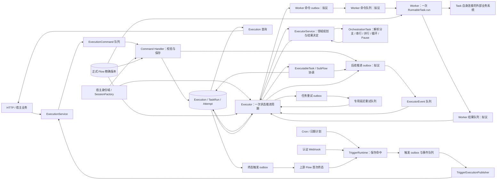
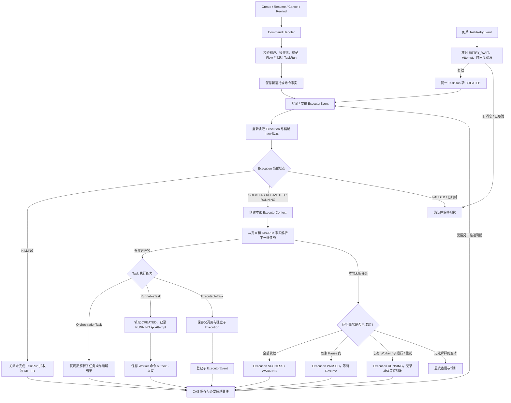
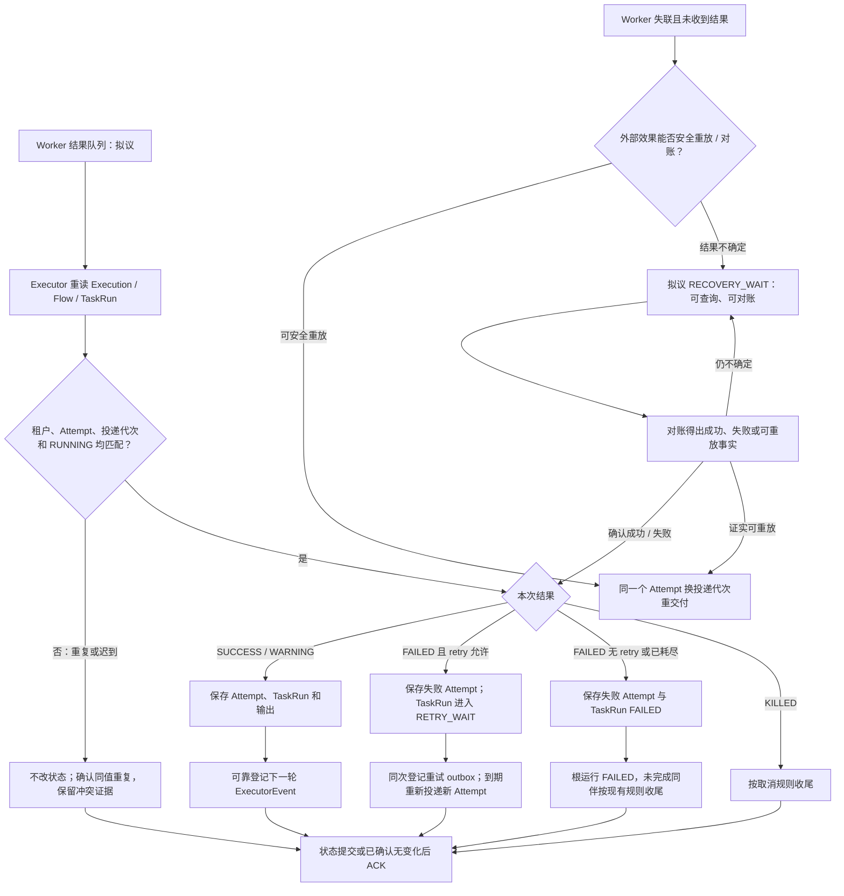
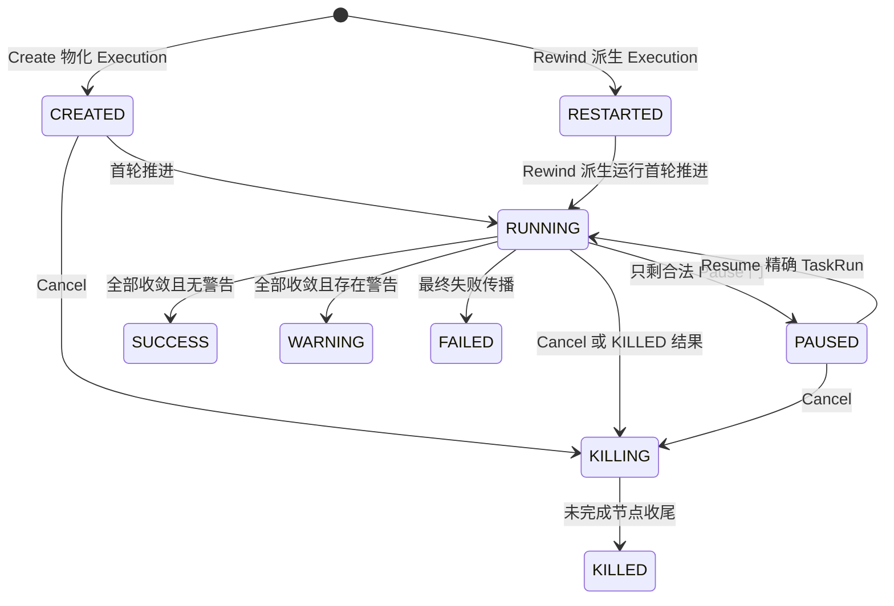
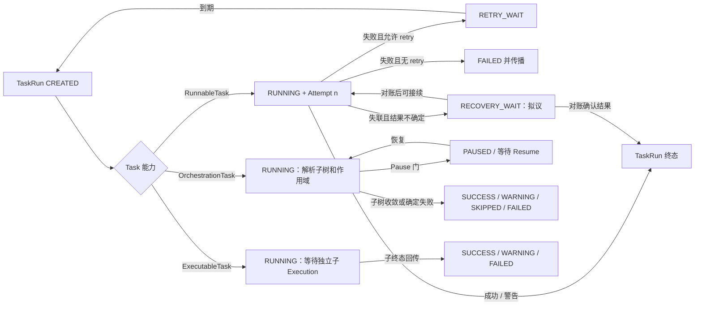

# ADR 0110：Executor 状态机全景与外部域连接

## 状态与定位

Proposed（2026-09-23）。本文把 Executor 的入口、状态所有权、一次推进周期、
Worker 结果回流和其他域的连接放在同一张模型中。RunnableTask 的异步结果与
失联协议以 [ADR 0109](0109-route-worker-results-through-executor.md) 为细化方案。
下图均表示**目标架构**；表中的“现有/拟议”标识不能省略。本文不修改运行代码、
数据库结构或 UC，也不把尚未验证的恢复能力写成现状。
持久化与失联恢复细节由
[ADR 0112](0112-study-kestra-state-persistence-and-recovery.md) 补充，包含 Kestra 2.x
源码顺序、实际事务边界及向 Flow DataSourceEngine / CAS / outbox 的映射。

## 背景与备选

当前入口包括公开 Execution Command、内部 Executor Event、延迟重试事件、
子运行完成回传；触发器先产生稳定命中，再借公开 Create 命令启动运行。
`ExecutorService` 按精确 Flow 版本和已保存的 Execution/TaskRun 事实规划，
Worker 只执行 RunnableTask。方案提出时 Handler 在同一事件处理中同步调用 Worker；
这造成 [恢复验证报告索引](../test-reports/README.md) 中 RUNNING 失联
无法继续的缺口。仅画一张 `TaskRun` 状态图会遗漏命令、子流程与消息交接。

备选为：把每种 Task 自行实现调度与恢复；或将所有入口和状态变化塞入一个
全局枚举。前者会复制取消/重试规则，后者混淆 Execution、TaskRun、Attempt 和
传输事实。建议以 Executor 为状态决策中心，按不同身份分别描述状态，并让各域
只通过稳定命令、结果或持久化事件连接。

## 一、外部域与完整运行链路

图中的 Trigger 域、Worker 域、宿主业务和 PostgreSQL/Pulsar 都在 Executor
状态决策之外。Trigger 只负责“何时、为何、以哪个稳定身份启动”；Task 插件
提供编排规则、一次调用行为或子运行请求/结果映射；宿主通过 `ExecutionService`
提交命令并查询结果。
上游终态通过与 Execution 同次保存的触发 outbox 回到 Trigger 域，匹配
`FlowTrigger` 后再走 Create。此处没有审批域或审批状态。

## 二、Executor 的入口和一次推进周期

每个 ExecutorEvent 只携带租户、运行身份和生命周期类型；本轮
`ExecutorContext` 是短暂规划对象，不跨队列保存。`OrchestrationTask` 在
Executor 内解析，**不会**进入 Worker 队列。`ExecutableTask`（当前典型为
SubFlow）创建独立子 Execution；父 TaskRun 等待子终态。一次 ExecutorEvent
处理一个调度周期；编排产生新事实后先保存，需要继续时由下一事件重读运行事实。
这条循环必须能停在外部结果、合法等待或终态，不能靠空事件无限自旋。

## 三、Worker 结果、重试与失联的决策流程

Worker 的结果只是一次调用事实；Executor 才能更改 TaskRun、决定业务 retry
并推进 Flow。失败结果也必须先保存失败 Attempt。`FAILED` 且未配置 retry 时
不会进入成功后续节点。`RETRY_WAIT` 和其后的 Attempt n+1 属于业务重试；
Broker 重投及失联后的同次 Attempt 接续不消耗 `retry.maxAttempts`。
`RECOVERY_WAIT` 仍是拟议等待语义，不是当前 `State.Type` 成员。
对账确认走单独的恢复入口，凭可信对账事实复用结果分发；它不要求
`RECOVERY_WAIT` 再伪装成普通 `RUNNING` Worker 回报。

## 四、四个状态层次

上图只表示 **Execution 根状态**。Rewind 创建带来源关系的派生 Execution，
其 `RESTARTED` 不是原实例从终态倒退。`RETRY_WAIT` 属于 Runnable TaskRun，
此时根 Execution 仍为 RUNNING；SubFlow 父调用等待子运行时亦然。

| 层次 | 谁写入 | 关键状态与事实 | 不能混淆的含义 |
| --- | --- | --- | --- |
| Execution | Executor 经聚合方法和 Repository CAS | CREATED、RUNNING、PAUSED、RESTARTED、KILLING、终态；来源与精确 Flow 版本 | 根 RUNNING 可表示 Worker、子运行、重试或编排作用域等待；不能据此认定有线程在执行 |
| TaskRun | Executor 经 Execution 聚合方法 | CREATED、RUNNING、RETRY_WAIT、PAUSED、SKIPPED、终态；拟议 RECOVERY_WAIT；parentId、iteration、generation | 一次循环迭代或子调用有自己的 TaskRun；Pause 不是 Worker 的返回状态 |
| TaskRunAttempt | Executor 在领取及消费 Worker 结果时写入 | 第 n 次实际业务调用的开始、结束、结果和错误 | 消息重复或同次失联恢复不新增 Attempt；业务 retry 才产生 n+1 |
| 消息交接 | 各 outbox 发布器与 Broker | 待发布、已发布、待消费、已 ACK/NACK | Broker 受理或积压为 0 不能证明 Execution 已收敛 |

拟议的 Worker 实例、当前投递许可和结果记录属于第四层技术事实，承载 owner、
leaseUntil、deliveryGeneration、resultId 与处理决定；它们不加入 State.Type，
心跳和同次交付不会增加业务 Attempt 或追加 RUNNING 历史。结果应用和下一消息
登记则必须与 Execution 根 CAS 同次提交。ADR 0112 的启动/周期恢复扫描从这些
持久事实接续，不能只读取根 RUNNING 就推断 Worker 存活或批量重置任务。

不同 Task 能力的 TaskRun 路径也不同：

## 五、外部连接与可靠性交接

| 连接 | 输入与回执 | 状态所有权及交接要求 | 当前情况 |
| --- | --- | --- | --- |
| HTTP/宿主 ↔ ExecutionService | Create、Resume、Cancel、Rewind；返回队列受理或查询快照 | Command Handler 校验与保存，ExecutorEvent 唤醒运行；查询读取持久化结果 | 命令和查询已有；部分保存后直发事件窗口需审查 |
| 宿主身份域 ↔ Command/Executor Handler | 最小租户与操作者身份 | SessionFactory 恢复可信上下文；消息不能携带可变 Session 对象，Worker 只收调用变量 | 当前已有最小会话恢复 |
| Scheduler/Webhook/FlowTrigger → ExecutionService | 稳定 trigger_run、目标版本、输入及 executionId | Trigger 域原子登记命中/outbox，再用现有 Create 链路；不直接改 Execution | 已有；终态消息与命中有专属持久化协议 |
| Flow 定义与 Task 插件 → Executor | 精确已发布 Flow 版本、Task 能力与配置 | 定义只参与规划；Executor 负责所有状态变更 | 已有；Pause timeout 等独立缺口见 ADR 0108 |
| Executor → Worker → Executor | Worker 命令、结果事件 | 拟议命令/结果队列；Worker 不写 Execution/TaskRun；结果入库后 ACK | 当前仍为同步调用，ADR 0109 尚未实施 |
| Executor ↔ SubFlow | 父 TaskRun 与子 Execution 的稳定关联 | 保存父/子关联；子终态合并父最新快照并唤醒父周期 | 基本链路已有；取消、Replay 及部分保存/发布崩溃窗口待闭环 |
| Executor ↔ 延迟重试队列 | TaskRetryEvent 标识预期 Attempt 和到期时间 | 现有 retry outbox 原子登记；到期只唤醒匹配 RETRY_WAIT | 已有；只支持 RunnableTask 显式配置的业务 retry |
| Executor ↔ PostgreSQL/Pulsar | 聚合 CAS、outbox、至少一次消息 | 状态及下一必要效果须有原子登记或等价可恢复事实；重投只重算/重存，不重跑已确认 Worker 结果 | retry/trigger outbox 已有；Worker 命令与统一后续推进 outbox 拟议 |

跨域连接的共同不变量是：先持久化身份与状态，再发布可重复的交接消息；消费方
重读最新事实并做幂等判定；只有状态和下一必要效果持久化后才确认输入消息。
PostgreSQL 与 Pulsar 没有共同事务，不能把连续两次方法调用描述成原子交接。
取消与结果竞争、父子终态回传、终态触发发布都必须服从这一规则。
宿主自身事务与 Flow Command 队列同样没有共同事务；需要可靠启动时由宿主
保存稳定 executionId 并负责重投或本地 outbox，Flow 的 Create 重投保持同一身份。

## 影响与验证顺序

本文将 ADR 0109 放进完整运行模型：实现时要分别落地 Worker 命令/结果队列、
执行许可与失联处理、后续推进可靠交接，并审查 Command 与 SubFlow 的保存—发布
窗口。对 `RECOVERY_WAIT`、Task 可重放/对账契约、父子取消和 Replay 接续仍需
确认可观察的业务预期，再更新 UC。架构图本身不代表通过生产级高可用验收。

源代码入口：[ExecutionService](../../core/src/main/java/org/cses/flow/core/services/executions/ExecutionService.java)、
[Command Handler](../../core/src/main/java/org/cses/flow/executor/handlers/ExecutionCommandEventHandler.java)、
[Executor Event Handler](../../core/src/main/java/org/cses/flow/executor/handlers/ExecutorEventMessageHandler.java)、
[ExecutorService](../../core/src/main/java/org/cses/flow/executor/ExecutorService.java)、
[SubFlow Handler](../../core/src/main/java/org/cses/flow/executor/handlers/SubFlowExecutionHandler.java)、
[TriggerRuntime](../../core/src/main/java/org/cses/flow/scheduler/TriggerRuntime.java)。
