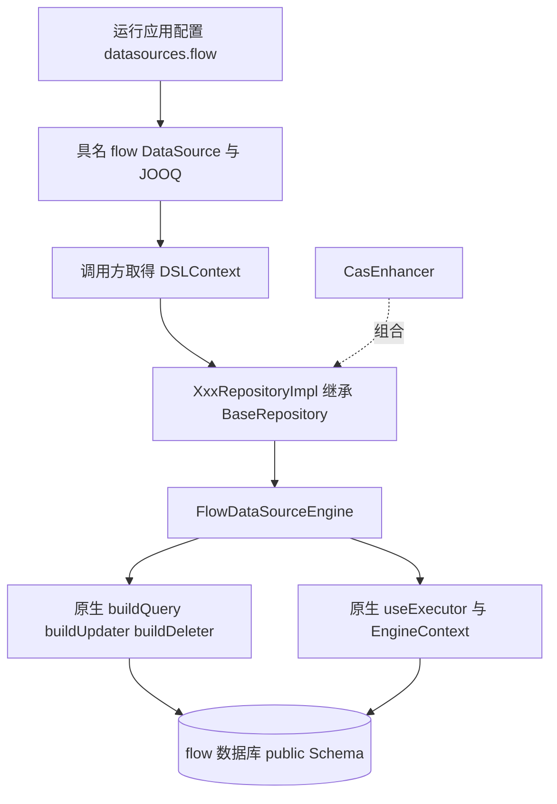

# ADR 0111：通过 DataSourceEngine 统一 CRUD 与 Repository 增强组合

## 状态

Accepted（2026-10-10；Engine 与 Repository 组织已落地，验证记录见下文）。

本文记录已确认的方案：Flow 数据库 CRUD 通过 `FlowDataSourceEngine` 进入
DataPilot 的原生能力，公共能力为 `BaseRepository`，各业务使用
`XxxRepositoryImpl`，CAS 由组合式 `CasEnhancer` 提供。

沿用 [ADR 0040](0040-bind-flow-datasource-from-host-yaml.md) 的具名数据源配置和
[ADR 0056](0056-bind-paas-jooq-to-named-datasource.md) 的同名 JOOQ 装配。
修订 [ADR 0097](0097-carry-lock-in-aggregate-and-inherit-cas-repository.md) 的
`CasRepository` 继承组织；对象携带 `lock`、原子保存、回滚后重载协议继续有效。
[ADR 0084](0084-save-domain-snapshots-without-business-transactions.md) 的 Worker、
快照保存及事务边界继续有效。

## 背景

用户所说的“使用数据源”指通过 `DataSourceEngine` 完成数据库 CRUD；仅统一
JDBC 连接池与 JOOQ 装配不能满足要求。数据库仍是 PostgreSQL `flow`，连接值
支持配置，独立 Server 和嵌入宿主采用同一个配置契约。

Flow 的追加版本、Execution 的 CAS 快照保存、触发命中和调度排他领取具有不同
协议。公共数据库基础应复用 CRUD，而业务实现需要保留聚合装配和特有操作。
CAS 增强与基础 Repository 采用组合关系，不形成增强器继承链。

## 备选方案

| 方案 | 判断 |
| --- | --- |
| 只统一 DataSource，Repository 直接执行 JOOQ | 不满足用户明确要求的 Engine CRUD 入口 |
| 每个业务直接调用 Engine，重复 CRUD 与兼容处理 | 公共能力散落，各业务容易采用不同调用协议 |
| 直接继承 DataPilot BaseRepository 并采用默认 save/version | 单 Model 返回值、默认保存和 Integer 版本不能承接现有聚合协议 |
| Flow BaseRepository 调用原生 Engine Builder，复杂操作使用 Engine 执行器 | 采用；复用实际 CRUD，保持聚合原子协议和业务接口 |
| CasEnhancer 继承 BaseRepository | 不采用；增强通过组合选择，避免多功能增强形成继承链 |

## 决策

### 数据源配置与所有权

运行应用提供标准 `datasources.flow.*`，Micronaut 创建并关闭具名连接池。
Flow 的数据库与数据源键不会随宿主默认库改变。

| 边界 | 约定 |
| --- | --- |
| DataSource / JOOQ / Configuration 名称 | `flow` |
| Engine 类型、key | `FlowDataSourceEngine`、`flow` |
| DataPilot 数据源键 | `postgresql.flow` |
| DbDataSourceOption.name / dbName | `flow` / `flow` |
| PostgreSQL Schema | `public` |
| 配置项 | URL、账号、密码、SSL、连接池容量和超时等标准属性 |
| 连接池所有者 | 实际运行应用的 ApplicationContext |

```yaml
datasources:
  flow:
    url: ${FLOW_DATASOURCE_URL:`jdbc:postgresql://127.0.0.1:5432/flow`}
    username: ${FLOW_DATASOURCE_USERNAME}
    password: ${FLOW_DATASOURCE_PASSWORD}
    driver-class-name: org.postgresql.Driver
    maximum-pool-size: ${FLOW_DATASOURCE_MAXIMUM_POOL_SIZE:10}
    minimum-idle: ${FLOW_DATASOURCE_MINIMUM_IDLE:2}
```

独立 Server 使用自己的有效配置，嵌入 Micronaut 宿主时由宿主提供同一节点。
宿主可同时拥有 `datasources.default`，无需复制 Flow Factory 或 Repository。
`NamedJooqFactory` 按 DataSource 名称选择同名 Configuration，额外无限定名
Configuration 不参与 Flow 选择。`jooq.datasources.flow` 仅在覆盖方言或 Settings
时声明。配置错误不会回退到宿主库；更换连接值后重启应用。

应用启动前手工执行 `gen/sql/flow/001_create_flow_tables.sql`，本轮不增加建库、
建表或运行期迁移。其他容器的接入需另行适配生命周期，不承诺复制 YAML 即可使用。

### Engine CRUD 链路



`FlowDataSourceEngine.registerDataSources()` 从 `Public.PUBLIC` 的生成 Table / Field /
PrimaryKey 元数据注册完整 Flow 集合。表名、列名和复合主键不在代码中重复硬编码，
也不要求生成对象增加 DataPilot 注解。普通字段只承担数据库类型映射，不重新生成
领域的审计事实或使用 DataPilot VersionField 接管 `lock`。
`list(Entry.class)` 使用 DataPilot 原生 JooqDatabaseHandler 的类型化 `query` 映射，
保留数据库 `JSONB` 类型和下划线列到 Java 属性的映射。当前默认 Repository 的
ModelsComposite JSON 中转不能反序列化生成对象的 JOOQ `JSONB`，因此不采用该
中转路径；查询与映射仍由原生数据库 Handler 执行，Entry 再恢复领域对象。

| 操作 | 实际执行入口 |
| --- | --- |
| 普通单行、列表与计数读取 | `buildQuery(...).dsl(...).list(Entry.class)` / `count()` |
| 普通创建与冲突不覆盖创建 | `buildUpdater(...).dsl(...).batchCreate(...)`，单项列表；冲突策略使用 `onConflict().doNothingOn(...)` |
| 普通字段更新 | `buildUpdater(...).dsl(...).filter(...).update(...)`，复合主键由 FlowUpdater 适配原生 Handler |
| 普通删除 | `buildDeleter(...).dsl(...).filter(...).confirmDelete(true).delete()` |
| CAS、聚合 CTE、单快照 multiset、竞争条件更新、事务行锁 | `useExecutor(...).dsl(...).executeResult(...)`，在 EngineContext 选定的 Flow 会话上执行专用 SQL |

普通 CRUD 不通过自定义 JOOQ 包装绕过 DataPilot Handler。原生 Builder 不能表达
单语句父子 CTE、双根交接和 `FOR UPDATE SKIP LOCKED`，这些操作明确进入 Engine
原生执行器扩展；具体 SQL 仍由 Repository / 增强器构造，保持原子性。

现有 Repository 端口继续接收 DSLContext 与显式租户条件，不增加请求上下文缓存。
公共基础使用 `Session.Robot` 作为低层 Engine 技术会话；真实操作者及审计时间仍由
公开 Command 的可信 Session 在领域层产生，Entry 原样保存，不替换为 Robot。

### 借用事务与当前 DataPilot 适配

当前解析的 DataPilot 为 `2.5.11`。其标准 `.dsl(...)` 绑定依赖全局 DbFactory 与
Hikari 类型来推导会话名称。Flow 对原生 Builder 与执行器的 `getContext()` 提供
窄范围适配：每次创建独立 EngineContext，将传入的唯一 DSLContext 注册到
`flow` 的外部 `JooqDbSessionImpl`。不创建第二个连接池，不持有请求状态。

- 原生 CRUD 使用 EngineContext 内同一个连接与事务。
- Engine 可刷新当前操作的批量语句，但外部会话不提交、回滚或关闭调用方连接。
- 调用方继续负责显式事务及行锁生命周期；不跨 Worker 持有业务长事务。
- 借用上下文派生 Settings，关闭 Catalog / Schema 渲染，以适配 DataPilot 以
  dbName 表示 Schema 的元数据；实际 PG Schema 仍为 `public`，原 Settings 不被修改。
- 一次 Engine 调用不能传入多个 DSLContext；无显式 DSL 时保留 Engine 自建事务能力。

当前 `GetRequest.toFindRequest()` 通过 JSON 转换，运行时 `andJooq` 条件会丢失，
`GetRequest.Of()` 也不复制 pageSize。Flow 单行读取使用原生 `list` 后检查基数，
唯一查询多行明确失败，最新版本查询显式 `pageSize(1)`。不调用该路径的 `single()`。
生成条件仍通过原生 QueryCondition 的 JOOQ 扩展进入 Handler，保留租户、业务身份
和复杂子查询；ES、缓存、父类关联装配关闭，聚合由业务 Entry 恢复。
当前缓存代理即使收到 `cache(false)` 也会先读取单列 `getPkName()`，无法处理
Flow 的复合主键。注册 Flow 集合后仅移除该缓存代理，保留原生 Trino 查询代理和
JooqDatabaseHandler；这是 Flow 集合的数据库快照约定，不改变宿主其他 Engine。
默认 `count()` 对 `MetaModel.getPk()` 的第一列做 DISTINCT，复合主键下会把同一
租户的多条记录合并为一条。FlowQuery 对复合主键的筛选计数调用原生 Handler 的
COUNT 聚合，计数列取生成主键的非空列；原筛选条件保留，分页不限制总数。
计数仍在数据库完成，不通过加载所有行统计，也不识别租户或业务身份字段。

### BaseRepository 与业务组织

Flow 的 `BaseRepository` 位于基础设施 Repository 包，注入具体
`FlowDataSourceEngine`，公开业务能力仍通过各业务端口提供。
构造器只接收 Engine 与 Table 元数据；基类不持有或校验 `companyId`、`id`，
也不提供租户或业务身份条件。各业务 `XxxRepositoryImpl` 自行校验业务字段并
传入完整条件；公共基础只处理 CRUD 与生成表的主键元数据。

| 公共能力 | 边界 |
| --- | --- |
| 表元数据 | 绑定生成 Table / PrimaryKey，不绑定业务字段或构造业务条件 |
| query / readOne | 原生查询及明确的单行基数检查 |
| create / createIfAbsent | 原生创建，冲突字段来自生成主键元数据，不负责业务字段校验 |
| updateFields | 原生筛选更新，不允许改写生成主键；显式 NULL 使用 `SetNullOperator` |
| deleteRows | 原生删除，业务提供完整筛选条件 |
| execute | 原生执行器扩展，保持借用事务及原异常类型 |
| insertStatement / updateStatement | 只构造未执行语句，供 Engine 执行器内的聚合 CTE / CAS 组装 |

DataPilot 2.5.11 的单项 `create` 在写入后的追踪阶段调用 `Model.getPkValue()`，
复合主键会抛错。公共创建采用原生 `batchCreate` 的单项列表，保留原生创建 Handler
及冲突语义。其 `DbRepository.update(filter)` 也以 `getPkName()` 提取单列主键，
其字段 Map 分支也会在 PK parser 中假设单列主键。FlowUpdater 对复合主键的筛选更新
使用原生 Handler 查询完整 Model，再应用经过归一化的字段与操作符，调用原生 Handler
更新，保留校验、数据事件和完整主键 SQL。BaseRepository 仍只调用 Engine Builder。
此兼容不将复合主键改为单列，不绕过 Handler；普通更新沿用查询后逐行更新的语义，
竞争条件更新和 CAS 始终使用 Engine 执行器内的单语句协议。

公共基础只对数据库类型做适配：把 JOOQ `JSON` / `JSONB` 包装值解析为 Engine
原生 JSON 树，保持数组、对象和标量根节点形状；不解释字段的业务内容。

基类不定义通用于所有领域的公开 save/upsert，不复制反射映射、JSON、ID 或时间
工具。表与 Engine 是稳定成员；Session、租户、DSLContext、快照、lock 不缓存在成员中。

| 业务实现 | 保留的专有协议 |
| --- | --- |
| FlowRepositoryImpl | 追加版本、新行 ID、完整 Task 定义与配置事件原子保存，返回隔离快照 |
| ExecutionRepositoryImpl | 完整根、TaskRun、retry/terminal outbox 单 SQL；源与派生双根单 SQL |
| TriggerRepositoryImpl | 来源幂等锁、命中与事件原子保存、事件标记及同租户来源追踪 |
| ScheduleRepositoryImpl | 调度短事务、排他领取、命中身份推进与失败延后 |

`ScheduleRepository` 为 Scheduler 端口，实现继承 Core 的公共基础；TriggerRuntime、
TriggerExecutionPublisher、WebhookTriggerService 通过触发端口完成持久化。
Task / TaskRun 继续属于所在聚合，不按表数量新建平行领域 Repository。
Entry 继承生成对象并独占 `from/to` 转换，Codec 与 entries 平级，Core Domain 不依赖
Engine、基础 Repository、增强器或数据库生成类型。

业务字段校验、租户隔离和聚合身份条件归各业务实现所有。跨类字段与参数名称定义在 `org.cses.flow.common.Fields`，当前共用 `id`、
`companyId`、`dsl`；类内使用的 `table`、`fields`、`lock`、注入参数名为私有常量。
数据库 Map 列名来自 `Field.getName()`，JSON 的 `companyId` 不替换 SQL 的
`company_id`。编译期常量使用 `static final`，名称值保持既有协议。

### CasEnhancer 的组合协议

`CasEnhancer` 无请求状态，与 BaseRepository 无继承关系。Execution 实现通过
构造注入组合它。增强器构造根 CAS、检查完整 SQL 的结果并表达冲突，业务实现
组装子集合与 outbox，通过 BaseRepository 的 Engine 执行器执行后才回填版本。

| 输入 lock | 行为 |
| --- | --- |
| null | 只 INSERT，成功为 0；同租户同身份重复新建反馈冲突 |
| 非负已有值 | WHERE 同时匹配租户、身份、加载版本，成功递增 |
| 负数 / Long.MAX_VALUE | 拒绝无效值 / 溢出，不覆盖已有结果 |

版本保持 `Long` / PG `bigint`。UPDATE 未命中不退为 INSERT，新建冲突不覆盖更新，
无成功根行抛出 `DataChangedException`；SQL / 约束故障沿用 `WorkflowException`。
子记录及 outbox CTE 以成功根行作为门控，任一子写入失败整条 SQL 回滚。
源与派生双根共同成功或共同失败，不能拆分保存再补偿。

构造根语句前通过 `CasEnhancer.fields(...)` 复制 Map 并去除版本列，避免字符串
Map 键与类型化 lock Field 混用产生重复列。增强器统一控制版本值，更新不修改身份。
SQL 失败不回填版本；外层显式事务回滚后必须丢弃对象并重新加载。

本轮源码与编译产物核对发现 DataPilot 2.5.11 的 JooqDatabaseHandler.update
把版本条件加入局部 conditions，最终 WHERE 却仍使用 model.buildPkCondition()。
这属于静态证据。因此使用 Engine CRUD 不代表采用其默认 VersionField 作为 Flow
CAS；本轮通过组合增强和 Engine 执行器保持原并发协议，不修改外部依赖。

### 工具边界

Generator 使用自己的可配置 HikariDataSource 与 GenerationTool.setDataSource，
不是业务 CRUD，不启动 Core / Engine；保留 FLOW_JOOQ_JDBC_URL/USER/PASSWORD。
真实 PG 测试自行管理可关闭连接池，业务 Repository 使用真实 Engine Builder / Handler，
技术测试可以省略与 CRUD 无关的外部消费者、Redis 和 ES 生命周期。
正式 Micronaut Engine 仍保留 DataPilot 原有外部组件装配要求；`datasources.flow`
定义数据库连接，不替代其他组件配置。本轮轻量 Engine 的真实 PG 验证不证明这些
外部组件及完整 Engine 启动生命周期。

Schema、生成对象、UC 预期、Worker 协议保持不变。运行与宿主配置见
[数据源手册](../harness/flow-datasource.md)。

## 验证记录

Engine 接入后的真实 PG 专项按 class + method 合并每项最新独立证据，49/49 通过、
0 跳过；没有把重复轮次累计为测试数量。覆盖原生 CRUD、复合主键及租户隔离、
显式 NULL、JSON 根节点形状、最新版本和分页计数、宿主库隔离、CAS 竞争、聚合
回滚以及借用连接与事务生命周期。架构两方法独立复验通过，调度短事务与可靠性
9/9 通过，独立子 JVM 的 UC19 S6 强杀恢复预检通过。
证据位于 `build/adr0111-validation/20261010/engine-technical-latest.json`、
`engine-architecture-and-retry-recheck.log`、`engine-scheduler-preflight.log`。
生成器在独立 PG 上验证 29 个输出归一化后一致，池关闭后连接归零；本轮未更改 Schema。

Engine 接入后的完整模块测试共 555 项：544 通过、10 失败、1 跳过。
Core 为 493 项（491 通过、1 State 失败、1 跳过），Scheduler 为 38 项
（29 通过、9 次 UC19 恢复窗口调用失败），Server 为 24 项（全部通过）。
两个 AOT 构建任务均因 classpath 中 application 配置资源重复而失败，同日志另有
XML 解析器特性不支持异常；
完整 `./gradlew test build --continue` 退出码为 1，不能报告测试或构建整体通过；
独立 UC01 13/13、UC04 11/11、UC16 主场景与 HTTP 边界 2/2 通过，
均为 Engine 接入后的实际执行，0 跳过。UC19 独立主类为 12 场景中 4 通过、8 失败，
参数化展开后为 14 项中 5 通过、9 失败。首次失败的 8 个 UC19 方法各自独立复验，
展开后的 9 项仍全部失败，State 单方法复验仍失败。逐场景结果、未解决反例及
复现方式见 [批量报告](../test-reports/flow/BATCH-2026-10-10-1823.md)，
UC19 细节见 [独立报告](../test-reports/flow/UC-19-2026-10-10-1823.md)。

HEAD a56278a 在相同环境复现 State 单方法和 UC19 S3/S4，其他恢复及构建失败
尚无逐项 HEAD 对照，不能全部归为既有问题。接入前完整轮为 550 项
（539 通过、10 失败、1 跳过），仅保留为过程证据，不能作为 Engine CRUD 验收。
两次有界中止的全量运行不计为完整测试结果。

保存真实失败现场后，测试代理已清理两个专属容器及匿名卷、私有环境和 HEAD
归档；清理前最终活动连接、消费者、运行、等待和计划均为零。UC19 失败轮曾遗留
9 个 RUNNING 根和 14 个 RUNNING 任务，物理清理不代表业务恢复，报告保留该事实。

真实数据库专项已覆盖 Engine 调用、租户同身份隔离、最新版本读取、显式 NULL、
CAS 竞争和子写入失败原子回滚、借用连接与事务生命周期、宿主库隔离，以及调度锁。
本轮使用命令作用域 JDK 25；当前依赖存在 Java 21 解析约束，不能报告 Java 21
兼容性通过。完整轮唯一跳过项为环境门控的压力测试，不记为真实验收。

## 理由与后果

数据库 CRUD 有明确的 Engine 入口与配置所有者，公共基础复用原生能力，各业务
仍有独立的持久化契约。组合增强保留已经使用的 CAS 与聚合原子保存。

代价是对当前 DataPilot 借用上下文、Schema 渲染和单行查询做窄范围兼容处理，
并保留无法由普通 Builder 表达的 Engine 原生 SQL 扩展。后续升级 DataPilot 时
需重验这些边界，不能因默认版本能力存在便删除并发与原子性验证。
