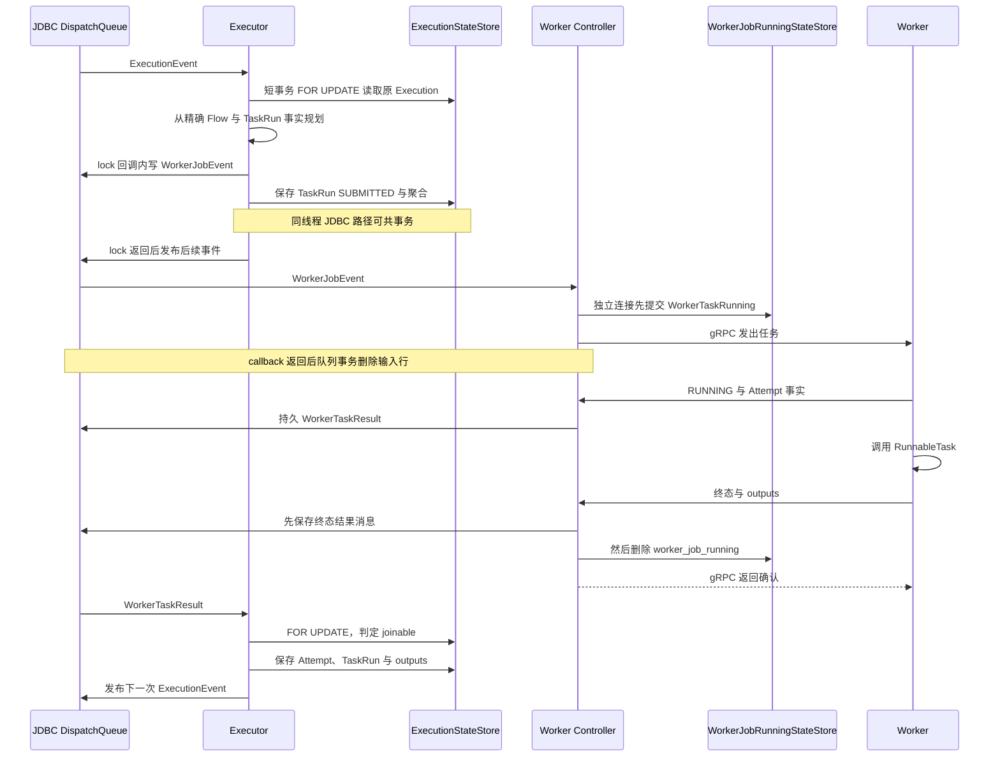

# ADR 0112：研究 Kestra 状态持久化与失联恢复，补充 Flow 运行交接方案

Worker 任务提交、结果回流及 outbox 生命周期的已确认方案见
[ADR 0113](0113-submit-worker-tasks-and-clean-consumed-outbox.md)。下文提案中的投递前 RUNNING、
长期消息保留及待定队列条款已由该记录修订；Kestra 研究和其余未确认范围保留原状态。

## 状态与范围

Proposed（2026-10-12）。本轮完成源码研究和方案细化，**没有实现 UC19 的运行恢复、
新增数据库表、修改 UC 或执行 Kestra 故障测试**。用户已要求先研究 Kestra，再按 Flow
既有方案补充细节；本文不将尚未确认的产品行为改写为 Accepted。

本文补充 [ADR 0109](0109-route-worker-results-through-executor.md) 和
[ADR 0110](0110-model-executor-state-machine-and-domain-links.md)，沿用
[ADR 0111](0111-unify-flow-datasource-and-compose-repository-enhancers.md) 的
`DataSourceEngine`、纯 CRUD `BaseRepository`、业务 `XxxRepositoryImpl` 和组合
`CasEnhancer`。运行目标仍是 [UC19](../uc/flow/UC-19%20原生流程运行崩溃恢复.md)
已确认的原实例、原版本、已完成步骤与轮次保持，并接续未完成部分。

## 背景

Flow 当前先保存 `RUNNING` 和 Attempt，再同步调用 Worker；恢复规划只领取
`CREATED`。崩溃发生在原 Attempt 未完成时，单靠重投推进事件无法接续它。
最近 UC19 的 9 次失败调用分布在 8 个场景中，共同缺少在途 RunnableTask 的恢复事实
和接续协议；测试证据见 [2026-10-10 UC19 报告](../test-reports/flow/UC-19-2026-10-10-1823.md)。

需要借鉴的是“保存哪些事实、谁拥有状态决定、如何从失联事实恢复”，而不是把
Kestra 的类名、表结构、全局状态枚举或部署拓扑复制进 Flow。

### 研究基线与证据边界

- 本地只读仓库：`/System/Volumes/Data/workspace/java/kestra`。
- 固定源码提交：`30082712303ebdc8c87d091cf5ac9ff6cc41fe13`，提交日期
  2026-09-09；该提交的 `gradle.properties` 为 `2.1.0-SNAPSHOT`。
- 本地 `Flow.java`、`State.java`、`RunContext.java` 已有未提交修改，另有研究文档。
  本轮没有修改它们；涉及 `State` 的说明以 `git show HEAD:...` 读到的已提交版本为准。
- 已用官方固定提交源码与官方文档交叉核对。官方 2026-09 的 2.0 说明确认已拆分
  Worker Controller，并移除 1.x 的双 Executor 实现。本文研究当前本地 2.x 路线，
  不将网上旧 `JdbcExecutor` / Kafka Streams 资料当成本提交实现。[官方 2.0 说明][k-overview]
- 源码分析能确认顺序、条件和事务 API；没有运行 Kestra，不能据此声称各崩溃窗口
  已经通过，也不能给 Kestra 全链路赋予 exactly-once 保证。

## Kestra 的实现逻辑

### 1. 状态、尝试、输出与恢复事实分别存放

| 事实 | 本提交 JDBC / PostgreSQL 存放位置 | 所有权及用途 |
| --- | --- | --- |
| Execution 状态、输入、精确 Flow revision、父子关联、TaskRun 列表 | `executions.value` JSONB；常用查询列从 JSONB 派生 | Execution 是推进读取的聚合快照 |
| TaskRun 身份、父节点、iteration、State 与 histories | Execution 的 `taskRunList` 元素 | 编排依靠原 TaskRun 与历史，而非重建一份流程实例 |
| TaskRunAttempt 的 State / histories、workerId、日志 URI | TaskRun 的 `attempts` 列表 | 保留每次实际执行及重提交记录 |
| Task 业务输出 | `task_outputs`，超过配置大小时保存内部存储 URI | 输出与 Execution 状态分开；旧内联 outputs 仅作兼容 |
| Flow 最终输出 | `execution_outputs` | 同样避免放大 Execution 行 |
| 待消费命令、Worker 结果及推进事件 | JDBC `queues`，包含类型、routing key、key、offset、payload | 持久交接事实；不是 State 的历史日志 |
| 已交给某 Worker 的任务与恢复输入 | `worker_job_running.value` JSONB | `WorkerTaskRunning` 保存 TaskRun、Task、WorkerTaskData 和 WorkerInstance |
| Worker / Executor 等服务的状态及心跳 | `service_instance.value` JSONB；按状态及更新时间查询 | `ServiceInstance.updatedAt` 支持服务失联判定 |

以上由模型、表定义及 output service 共同核对。`worker_job_running` 的旧基线列名
`worker_uuid` 已由 2.0.01 迁移改成从 `workerInstance.uid` 派生的 `worker_uid`；
不能只看 baseline 就推断当前查询列。[聚合模型][k-execution]、[TaskRun][k-taskrun]、
[Attempt][k-attempt]、[PostgreSQL 基线][k-schema]、[2.0.01 迁移][k-schema20]、
[Task 输出保存][k-outputs]、[Execution 输出表][k-execoutputs]

Kestra 的 `State` 表达 `current + histories`，相同状态返回原对象；它不是持久队列或
恢复协调器。正常任务会经历 `CREATED → SUBMITTED → RUNNING → 终态`，其中
`SUBMITTED` 表示已向 Worker 交付链路提交。Flow 不必为借鉴恢复能力而新增这个枚举；
投递阶段可以用独立技术事实表达。[State][k-state]、[提交任务的 Handler][k-eventhandler]

### 2. 正常保存与交接顺序

Executor 的 `ExecutionEventMessageHandler` 在 `ExecutionStateStore.lock` 回调中规划，
为普通 RunnableTask 构造 `SUBMITTED`，写 Worker 命令，并接纳这个 TaskRun 快照。
`AbstractJdbcExecutionRepository.lock` 通过 `FOR UPDATE` 串行同一 Execution 的更新，
回调结束后 UPDATE 原聚合；不会持有该数据库事务等待用户 Task 执行。
[Handler][k-eventhandler]、[JDBC lock][k-lock]

Controller 在 gRPC 发送前提交 `WorkerTaskRunning`。未提供同类事务上下文时，
running store 使用 `requireNewTransaction` 独立连接提交，避免快任务的结果到达时
running 行尚不可见，导致终态删除没命中后留下孤儿记录。
发送失败则恢复容量、删除 running 行并重新入队。[Dispatcher][k-dispatch]、
[running store][k-runningstore]、[独立事务实现][k-tx]

Worker 构造 `RUNNING` Attempt 并发送中间结果，随后执行 Task，再发送终态；
Controller 先将结果写入持久结果队列，终态才删除 running 记录。Worker 本地
`WorkerQueue` 与 Sender 重发缓冲是内存队列，进程退出仍需要 running store 的失联
恢复，不能把这个内存缓冲当作 durable result outbox。[Worker Processor][k-processor]、
[结果回流][k-controller]、[Sender][k-sender]

### 3. JDBC 事务与 ACK 的精确边界

JDBC DispatchQueue 单次 poll 在数据库事务中：`FOR UPDATE SKIP LOCKED` 领取队列行，
调用消费者，消费者正常返回后删除输入行，最后提交。这里的删除相当于 ACK。
消费者抛出并传播异常时事务可回滚；配置 `fail-fast=false` 会吞掉处理异常并造成消息
丢失，所以“失败必重投”必须带上这一前提。[队列客户端][k-queue]、[消费者异常策略][k-subscriber]

`JooqDSLContextWrapper` 的普通事务同线程可加入调用方事务；同步 JDBC emit 在同一
线程时可与聚合保存共事务。**当前 DefaultExecutor 的 ExecutionEvent / WorkerResult
消费者实际使用 batch：按 executionId 分组后交给 CompletableFuture 线程池，再 join。**
因此外层队列 poll / delete 事务与处理线程的 Execution lock 事务不能归为一个事务。
Worker 命令在 lock 回调内写入，可与该聚合保存共同提交；`toExecution` 中的后续 emit
发生在 lock 返回后，是另一个边界。[事务包装][k-tx]、[实际 batch 消费][k-default]

静态代码不能证明“结果已经提交、后续事件尚未发出”的中断窗口自动闭合；结果重投时
可能被 `hasTaskRunJoinable` 过滤。该窗口需要专项崩溃实验，本文仅识别边界，不声称
已经复现 Kestra 缺陷。Flow 设计必须明确用原子 outbox 处理这个窗口，不能照搬一段
先 save 再 emit 的代码，或用 JDBC 注释为 PG + Pulsar 跨系统交接作保证。

### 4. 服务失联后从 running store 重交付

1. Worker 心跳更新持久 `ServiceInstance`。当前默认心跳间隔 3 秒，检测间隔 5 秒，
   session timeout 与 initial delay 均为 45 秒；这些是本提交默认值，不是 Flow 建议值。
2. Executor 的 `DefaultServiceLivenessCoordinator` 扫描运行服务；超时后把远端服务
   转为 `DISCONNECTED`。JDBC 扫描锁服务行并使用 `SKIP LOCKED`，多 Executor 可以
   协同竞争，不靠进程本地的一份 Worker 列表完成恢复。
3. 按 `workerTaskRestartStrategy` 立即重投、等待终止宽限期后重投，或不重投。
   默认 `AFTER_TERMINATION_GRACE_PERIOD`；`IMMEDIATELY` 源码明确提示重复执行风险。
4. 按失联 Worker 的 UID 从 `worker_job_running` 加锁读取已交付任务，沿用原 Task、
   TaskRun 和 data，以及原 Worker queue routing，构造新的 WorkerJobEvent。
5. `TaskRun.onRunningResend` 将最后未结束 Attempt 标为 `RESUBMITTED`（必要时创建
   该记录）；新的 Worker 执行时追加新的 RUNNING Attempt。它不是 Flow 已提议的
   “同一业务 Attempt，只增加投递代次”。
6. 旧 Worker 重新有响应时，liveness 会使失效服务停止，减少僵尸执行；但停止进程
   无法撤销已经发生的外部效果，也不构成外部系统 fencing。

见 [ServerConfig][k-serverconfig]、[liveness coordinator][k-liveness]、
[服务实例 JDBC 竞争扫描][k-service]、[TaskRun 重提交][k-taskrun]、
[Worker 自我断开][k-heartbeat]；官方说明也将恢复描述为至少一次，并展示多个 Attempt
和 `RESUBMITTED`。[官方 lifecycle][k-lifecycle]

### 5. 结果去重、迟到与取消边界

`WorkerTaskResultMessageHandler` 锁当前 Execution，再调用 `hasTaskRunJoinable`。
后者比较 TaskRun 身份、Attempt 数量、当前状态和历史长度；相同状态、落后的历史、
已终态之后的非终态结果会被过滤。join 成功才通知监听器，所以普通重复结果不会
反复触发监听器。[结果 Handler][k-resulthandler]、[joinable 判定][k-execution]

这套逻辑以**TaskRun 快照新旧**收敛，而不是 Flow 要求的显式
`attemptNumber + deliveryGeneration + resultId` 仲裁。所检查的 Task 结果模型没有
这套结果代次字段；Trigger 上的 dispatch epoch 也不能推导成 Task 结果具备 fencing。
两个不同终态或旧 Worker 已产生的外部效果，不能仅靠状态相同、历史更长就判定安全。
尤其本提交允许“Attempt 数增加”优先返回 joinable，不能从后面的终态判断推导
取消后一概拒绝任何新结果。[结果信封][k-result]、[joinable 判定][k-execution]

### 6. backend 与版本差异

| 路线 | 本轮可以确认 | 本轮不能据此宣称 |
| --- | --- | --- |
| 当前 OSS JDBC / PostgreSQL | 队列表与 repository 在 JDBC；上面列出的锁、删除 ACK、running store 和 liveness 路径 | 全部批量消费、异步线程和外部存储共一个事务；外部效果 exactly-once |
| 当前 2.x Enterprise Kafka 等 | 官方称实现相同 Queue / StateStore 契约，queue 和 repository 可独立选择 | Kafka queue 与 PostgreSQL / Elasticsearch repository 共享 JDBC 事务；EE 未检查实现的 fencing 语义 |
| 旧 1.x JDBC / Kafka Streams | 官方记录曾有两条 Executor 路线；仅用作版本背景 | 旧 JdbcExecutor / Kafka Streams state store 是当前本地实现 |
| 测试或内存运行 | JVM 本地上下文与缓冲可用于执行；H2 测试是 JDBC 实现的测试入口 | 内存对象可跨 SIGKILL 恢复，或测试 runner 能代替真实 PG / Broker 崩溃证据 |

以上版本与版本差异以 [官方架构][k-architecture]、[官方 backend 说明][k-backend] 和
实际本地模块交叉核对，不分析本轮无法访问的 Enterprise 源码。

## 备选方案

| 方案 | 判断 |
| --- | --- |
| 把全部 RUNNING 改回 CREATED | 拒绝；丢失真实尝试与执行者信息，外部效果可能重复 |
| 原样复制 Kestra JDBC 表和 Controller | 拒绝；Flow 采用 PG + Pulsar、CAS、分表聚合与现有公共数据库方案，拓扑并非本次目标 |
| 只增加 WorkerResult 队列 | 不足；Worker 未回结果、保存后发布前中断仍缺恢复事实 |
| 借鉴持久 running store 与心跳，补上原子 outbox、投递许可和明确结果身份 | 建议；保持 Flow 已有状态与业务重试语义，补齐失联和交接细节 |

## 建议决策：映射到 Flow 既有方案

### 1. 保持聚合与数据库组织，增加必要技术事实

现有 `executions`、`task_runs`、TaskRun 的 `attempts` / `retry_variables`、
`task_retry_messages` 和终态事件 outbox 继续使用。它们通过
`ExecutionRepositoryImpl` 的成功根 CAS CTE 门控共同保存。TaskRun 仍通过
Execution 聚合改变，不新增绕过聚合的 TaskRun CRUD Repository。
[当前聚合保存](../../core/src/main/java/org/cses/flow/infrastructure/repositories/executions/ExecutionRepositoryImpl.java)、
[现有表](../../gen/sql/flow/tables/task_runs.sql)

以下是**候选持久化事实**，不是本轮已新增的 Schema；最终字段、索引和 Java 类型
需要实施前设计。优先以一个结果表同时承接结果 outbox 与应用凭据，避免再建一份
生命周期相同的 inbox。

| 候选事实 / 表名 | 需要保存的内容 | 原子边界 |
| --- | --- | --- |
| Worker 进程 / `worker_instances` | 稳定进程实例 `id`、状态、服务端接收心跳时间、失联时间、协议版本 | 每次心跳短条件更新；重启生成新实例身份 |
| 本次投递许可 / `worker_deliveries` | company、execution、taskRun、attemptNumber；当前 deliveryGeneration、owner、leaseUntil、阶段、acceptedResultId、恢复原因 | 每个业务 Attempt 一份当前许可；换代必须和根 CAS、命令 outbox 同时成功 |
| 后续消息 / `execution_messages` | 稳定 messageId、kind、身份、精确版本、输入快照或确定引用、payload、发布时间与发布领取信息 | 命令 / 后续推进 / 取消通知与对应 Execution CAS 同次保存 |
| Worker 结果 / `worker_results` | 稳定 resultId、全部调用身份及代次、输出、错误、内容摘要、reportedAt、publishedAt、处理决定及 appliedAt | Worker 报告先持久化；Executor 应用凭据与状态、后续消息共同提交 |

`worker_deliveries` 的投递阶段表示 `PENDING / LEASED / REPORTED / SETTLED / REVOKED`
等技术事实，不复用 State 的业务终态。心跳不改聚合 `lock`；换代、完成、取消则必须
与根状态竞争收敛。历史投递代次至少由结果记录及恢复审计可追踪。

所有 CRUD 经 `FlowDataSourceEngine`：`BaseRepository` 只处理表元数据、CRUD 和
执行器扩展；业务实现构造身份及租户条件。`ExecutionRepositoryImpl` 组合
`CasEnhancer` 组装根、子记录与 outbox；新增 Worker runtime 持久化适配可使用
`WorkerRuntimeRepositoryImpl`，其职责仅为 Worker 进程、许可及结果交接事实，
不修改 TaskRun 的业务状态。普通原生 Builder、需要短行锁的 Engine 执行器和借用
DSLContext 继续遵守 ADR 0111，不能以这里新增事务为由绕开 Engine。

新表命名用复数，时间统一 UTC 毫秒 `bigint`，身份由 `StringUtil.newId()` 首次生成，
字段名称遵循 `common.Fields` / 类内常量规则，数据库列来自生成 Field 元数据。
Schema 继续人工执行可重建基线，不新增启动自动迁移，不复制 Kestra 的生成查询列、
DB enum、日期类型或数据库业务约束。

### 2. 明确身份与两种 Generation

| 身份 | 语义与校验 |
| --- | --- |
| `companyId + executionId` | 租户及原运行；全部查询、保存、结果处理保留租户条件 |
| `flowKey + flowVersion` | 原运行的精确发布版本；恢复不读取 latest 替换定义 |
| `taskRunId` | 已接纳的节点出现身份，循环与分支使用原 identity，不以 taskId 替代 |
| `attemptNumber` | 明确业务失败重试的编号；已有 Attempt 不因交付失败增加 |
| `deliveryGeneration` | 同一业务 Attempt 的技术投递许可代次，单调递增；不是 Execution / TaskRun 的编排 Generation |
| `messageId` | 某代次命令或推进事件身份；发布重试沿用原值，换投递代次才生成新的命令身份 |
| `resultId` | 一次确定结果的身份；网络重发沿用原值，并同时核对结果内容摘要 |
| `workerInstanceId` | 一次服务进程生命期身份；机器名、端口、队列订阅名都不能代替它 |
| `lock` | 当前 Execution CAS 版本；不作为业务版本、attempt 或 deliveryGeneration |

结果至少完整关联 company、Execution、TaskRun、Attempt、投递代次与 Worker 身份；
当前 `WorkerTaskResult` 只有运行、节点与 Attempt，可保持业务结果类型不变，由传输
事件补齐这些技术字段。传输载荷不能含凭据或可恢复 Session 对象。

结果正文已经持久化时，Broker 信封优先只传稳定结果引用、调用身份和摘要；Executor
通过同一 Flow Engine 读取正文后核对完整身份与摘要，再应用结果。这样不把任意大小
的输出直接塞入 Pulsar 消息，也不为借鉴 Kestra 而立即拆分现有 TaskRun 输出表。
若支持内联正文，实施时需明确消息大小上限和超限处理。结果记录与引用的保留期必须
覆盖消息重投及对账窗口，不能先清理正文再确认相关消息；具体保留时长仍待产品确认。

### 3. 保存—发布—ACK 的闭合顺序

**A. Executor 创建许可与命令。** 从已保存聚合领取 CREATED，登记 Attempt n、RUNNING、
输入上下文、初始 deliveryGeneration 和命令 outbox。根 CAS 不成功时，子任务、许可
及 outbox 均不能留下写入。成功提交后才 ACK 原推进输入；命令由发布器发送，
Pulsar 确认后标记 publishedAt。确认后、标记前中断可重发同一 messageId。

**B. Worker 领取与执行。** 在短事务核对精确身份、当前代次、未取消且未完成的许可，
竞争设置 owner / leaseUntil 后才调用插件。相同命令重复到达时，已有有效 owner 则
不再执行；已经保存结果则只重发结果；已经失效则持久记下原因后确认。Worker
调用期间不持有 Execution 行锁或数据库事务。

**C. Worker 报告结果。** 将完整结果、resultId、摘要及对应许可的 REPORTED 事实先
原子写入 `worker_results`，结果发布器向 Pulsar 投递。以 ADR 0109 为默认 ACK 协议：
结果得到 Broker 确认后才 ACK 命令。结果 outbox 使 Worker 在确认命令前后退出都可
重发已得到的结果；不能重新调用插件来“补发结果”。当前架构中这是技术事实写入，
并非 Worker 改 Execution / TaskRun 状态。

**D. Executor 应用结果。** 重读原聚合，核对完整身份、当前 Attempt、代次和许可，
决定成功、失败、RETRY_WAIT 或取消收尾。一次提交写入根 CAS、Attempt 结果、
TaskRun 输出和状态、许可 SETTLED、结果处理凭据以及下一必要消息。重试继续复用
`task_retry_messages`；其他推进登记 `execution_messages`。提交后才 ACK 结果。
数据库错误 NACK / 重投；CAS 冲突重读重算，不再次调用 Worker。

单条 SQL 可表达时继续使用成功根 CTE 门控；多行领取与许可状态需要显式短事务时，
通过 Engine 使用同一借用 DSLContext，并在提交前核验各条件更新的基数。锁序固定，
没有有效许可、根 CAS 冲突或子写入失败时整次回滚。**“先写一张表，再写另一张表”
不是原子协议；也不能在 auto-commit 已提交之后才用 Java 异常宣称撤销整组写入。**

这些阶段不需要本轮额外引入 Worker Controller 或 gRPC。先保持现有部署形态、逻辑
Worker 和 Queue 抽象；如果将来支持远程无数据库 Worker，再由报告入口承接技术
事实保存，不让插件拥有 Repository。

### 4. 租约、心跳与恢复扫描

- 心跳记录服务端收到的时间，不能信任 Worker 请求自行声称的未来时间。时钟来源、
  检测间隔、lease timeout 和时钟偏差预算统一配置；先不给未经压力与暂停测试的数值
  承诺。实例心跳说明进程存活，投递心跳还要说明对应许可仍有效，避免活进程中一个
  Task 永久阻塞却一直被认为健康。
- 启动时与周期扫描都读取持久事实：未发布消息、已发布但未领取的命令、过期许可、
  已报告但未应用结果、需要推进而尚未关闭的消息。按候选行分批竞争，不能启动时
  一次性读取所有 RUNNING 并重置。
- 先处理已有确定结果及其 outbox / 重投，再处理无结果的失联许可。多个扫描器换代
  同一 Attempt 必须有共同根 CAS 与许可条件，只能产生一个新的有效代次。
- 如果还没领取，且持久事实证明插件未被调用，可重发原命令；如果调用可能发生，
  必须按 Task 的安全重放 / 对账契约分类。可重放任务沿用 Attempt n、增加代次；
  无法判断外部结果则持久记录不确定原因和恢复入口，不能伪造 FAILED 消耗 retry。
- 原许可被换代或取消后，旧 owner 心跳不续租，旧结果不覆盖当前聚合。Worker 在
  下一次调用前检查许可；检测到许可失效后停止后续调用并尝试中止当前调用。外部
  系统若不支持稳定幂等键或 fencing，框架无法撤销已发送请求或保证副作用只发生一次。
- 只有 Broker backlog 为零，或原事件被 ACK，都不足以判断业务已经恢复。恢复诊断
  必须同时展示原 Attempt、owner、代次、租约、结果及下一可靠交接事实。

### 5. 重复、迟到、冲突与取消竞争

| 情况 | 建议的持久决定 |
| --- | --- |
| 相同 resultId 且身份、摘要相同，已应用 | ACK，保持原状态和 outbox，不再推进 |
| 相同 resultId 但身份或内容不同 | 保存冲突证据并隔离，禁止静默覆盖 |
| 不同 resultId 竞争同一当前 Attempt / 代次 | 只接受一次有效结果；后到的不同结果保留冲突证据 |
| 旧 Attempt、旧代次、派生前旧 Execution 的结果 | 记录过期决定，不进入新实例或新代次 |
| 旧代次声称外部操作已经成功 | 保存外部效果证据并进入对账规则，不直接覆盖当前结果，也不忽略重复副作用风险 |
| Cancel 与结果同时到达 | 由同一根 CAS 决定先后；取消先提交则撤销有效许可、登记可靠取消通知，迟到输出仅留审计；结果先提交则按当前已完成事实处理取消 |
| 终态后命令或推进事件重到 | 校验原身份后确认，保持终态，不领取新的调用 |

拒绝或隔离也是一个明确处理决定，只有所需诊断事实可靠保存后才确认坏消息；
暂时数据库故障不能被当作消息永久无效而 ACK。取消表示逻辑运行结束，物理调用可能
仍需收尾，查询和审计应区分这两种事实。

### 6. 业务 retry 与技术重交付保持分离

Kestra 的 `RESUBMITTED` 与追加 Attempt 是可参考的操作历史表达，但 Flow 当前方案
已经区分业务 retry 和传输恢复，继续采用：

- 确定 FAILED 且策略允许：完成 Attempt n，保存 RETRY_WAIT 和原到期计划；到期才
  创建 Attempt n+1。
- 命令发布失败、消息重投、CAS 冲突：沿用原身份，不产生新的业务 Attempt。
- 失联后安全接续：Attempt n 不变，deliveryGeneration 增加，保留技术恢复记录。
- `warningOnRetry` 由业务 Attempt 计数决定；一次失联重交付后成功不会因此变 WARNING。
- 不把 lease timeout 当成 Task 的业务 timeout；后者只有在契约明确判定调用失败后
  才参与 retry。RETRY_WAIT 的原计划、历史失败及取消规则继续复用 ADR 0105 / 0106。

### 7. 已有 RUNNING 的接入策略

现有开发期 Schema 可以重建，但线上或需要保留的已有运行不能凭空补出投递许可。
新协议首次发现“RUNNING、有未结束 Attempt、没有 delivery 事实”时，标记为 legacy
结果不确定，并列出原版本、输入快照、Attempt 与 Task 恢复能力。

只有任务声明可安全重放，或业务对账证明原调用未生效，才以受审计的接续操作登记
初始许可与命令。不能用 Execution.createdAt 推算失联租约，不能将旧 RUNNING
批量置 CREATED，不能新建替代 Execution；已有终态、Pause、子流程关系和
RETRY_WAIT 沿用各自已确认恢复路线。

如果当前部署只使用可丢弃开发数据，可按既有 Schema 规范重建基线；保留数据场景
的导入 / 修复流程属于独立运维授权，不在启动时自动执行，更不在本轮新增迁移代码。

## 验证矩阵与实施顺序

以下是待实现协议的技术验证，不从它反推新的 UC 预期。新增可观察行为先由 UC Agent
整理确认，之后由 Test Agent 补测试和报告。原 UC19 的 12 个场景、14 个参数项保持。

| 故障窗口 / 竞争 | 必需观察结果 |
| --- | --- |
| RUNNING + Attempt + 命令 outbox 提交前 / 提交后强杀 | 前者整组不留下部分事实；后者原任务可获得交付，不丢命令 |
| Pulsar 确认命令后、publishedAt 标记前强杀 | 原 messageId 重投，没有第二个有效调用许可 |
| Worker 领取前 / 领取后、调用前强杀 | 接续原 Execution / TaskRun / Attempt，已完成节点不重跑 |
| 外部调用中 / 已生效、结果保存前强杀 | 可重放任务按契约接续；不确定任务进入可查询处置，不猜测失败或盲重放 |
| 结果已保存、发送前 / Broker 确认后、命令 ACK 前强杀 | 重发原结果，插件不为补消息再次执行 |
| Executor 保存结果前 / 结果和推进 outbox 提交后、ACK 前强杀 | 原结果可重投；应用与下游推进最多一次，不悬挂已完成节点 |
| 两个恢复扫描器、旧 Worker 迟到心跳或结果 | 只有一个当前代次；旧代次不能续租或改写新事实 |
| 相同结果重发、同 resultId 异值、不同终态竞争 | 去重或冲突决定可查，无静默覆盖，无重复汇聚 |
| 取消和结果 / 失联恢复 / retry 到期竞争 | CAS 后有效事实一致，取消后没有新的有效调用许可，迟到输出不成为下游输入 |
| Worker 活着但单任务卡住，长 GC，Broker / PG 暂停后恢复 | 心跳和租约的区分有效；故障结束后可靠交接继续，未确定效果不被重复制造 |
| 业务重试与同 Attempt 重交付 | Attempt、retry 次数、warningOnRetry 和原 deliverAt 各自正确 |
| UC19 编排与触发上下文 | 串行、路由、并行、两种循环、父子、重试及四类启动都沿用原身份并收敛 |
| 历史 RUNNING、Pause、终态、嵌入宿主数据源 | 分别分类处理；Engine 不落到宿主 default 库，终态保持，Pause 不因重启恢复 |

建议按同一条链路拆实施提交：

1. 固定结果身份、许可和恢复能力契约；确认新产品行为并补对应 UC。
2. 在可重建基线加入必要技术事实，生成 Entry，通过真实 PG 验证 Engine CRUD、
   CAS 门控、短事务及回滚；BaseRepository 仍无业务字段。
3. 接通命令 / 结果 outbox 和 Executor 异步状态决定，先完成正常成功、失败、重试、
   重复结果及保存—ACK 故障窗口。
4. 加入实例 / 投递心跳、失联扫描、换代、取消和安全重放 / 对账；再执行 UC19 全矩阵。
5. 完整回归、Broker 暂停恢复、竞争和长暂停验证通过后，才修订相关 ADR 状态和恢复
   能力说明。不能以单个恢复场景通过替代整条协议验收。

## 尚需确认的产品行为

1. 外部结果不确定时，是新增 `RECOVERY_WAIT` State，还是保持 RUNNING 并提供同等
   可见的恢复原因和处置入口？等待与告警阈值、人工确认成功 / 未生效 / 失败的权限
   及审计需要一起定义。
2. Task 如何声明安全重放、幂等键、对账能力？未声明的任务应采用保守不重放，还是
   允许管理者显式授权重放？仅确认 UC19 原生测试任务安全，不能推定所有宿主插件安全。
3. 收到旧代次的成功证据后，新代次已执行或仍在途时，如何报告冲突及对账结果？
   哪些人工动作可关闭等待、是否允许再次执行，需要具体用户场景。
4. 默认失联恢复速度与重复副作用风险如何取舍；租约、长暂停、重交付限额及无法恢复
   时的处理策略应明确，但本轮不编造 RTO 或生产参数。
5. 保留哪些已有 RUNNING 数据、结果及恢复审计，保存多久？当前“可重建开发基线”
   与将来“保留运行数据升级”应分开授权和设计。

这些事项不阻止本轮研究结论成立，但不能在实施中被悄悄确定。其他已授权的 State、
AOT、XML 修复与本方案分开交付。

## 理由与影响

可借鉴 Kestra 的持久聚合、独立 running store、先保存再交付、Worker 结果经队列
汇合、心跳与竞争扫描；它们直接解释了 Flow UC19 为什么缺少“谁仍在执行、失联后
从哪里拿到原调用”的事实。

Flow 必须补自己的跨 PG / Pulsar outbox、显式结果去重、投递代次、取消仲裁及
不确定效果出口。CAS 适配、领域 Attempt 计数、编排 Generation、数据源 Engine
入口、现有分表聚合和短事务边界继续有效。代价是新增少量技术事实及恢复协调，
好处是每个非终态能解释所等待的对象和可靠交接，不依赖进程内调用栈继续存活。

## 精确源码入口

下列本地链接指向本次核对位置；持久引用使用固定提交的官方源码。

| 实现入口 | 本地位置 | 固定提交来源 |
| --- | --- | --- |
| 聚合、joinable | [Execution](/System/Volumes/Data/workspace/java/kestra/core/src/main/java/io/kestra/core/models/executions/Execution.java:812) | [K1][k-execution] |
| 重提交 Attempt | [TaskRun](/System/Volumes/Data/workspace/java/kestra/core/src/main/java/io/kestra/core/models/executions/TaskRun.java:241) | [K2][k-taskrun] |
| Execution 行锁与保存 | [AbstractJdbcExecutionRepository](/System/Volumes/Data/workspace/java/kestra/jdbc/src/main/java/io/kestra/jdbc/repository/AbstractJdbcExecutionRepository.java:478) | [K3][k-lock] |
| Queue 锁行、回调、删除 | [JdbcQueueClient](/System/Volumes/Data/workspace/java/kestra/queue-jdbc/src/main/java/io/kestra/queue/jdbc/client/JdbcQueueClient.java:172) | [K4][k-queue] |
| 实际批量线程切换 | [DefaultExecutor](/System/Volumes/Data/workspace/java/kestra/executor/src/main/java/io/kestra/executor/DefaultExecutor.java:264) | [K5][k-default] |
| 命令创建顺序 | [ExecutionEventMessageHandler](/System/Volumes/Data/workspace/java/kestra/executor/src/main/java/io/kestra/executor/handler/ExecutionEventMessageHandler.java:260) | [K6][k-eventhandler] |
| Controller 保存后派发 | [WorkerJobDispatcher](/System/Volumes/Data/workspace/java/kestra/worker-controller/src/main/java/io/kestra/controller/grpc/services/WorkerJobDispatcher.java:904) | [K7][k-dispatch] |
| 独立提交 running 行 | [AbstractJdbcWorkerJobRunningStateStore](/System/Volumes/Data/workspace/java/kestra/jdbc/src/main/java/io/kestra/jdbc/runner/AbstractJdbcWorkerJobRunningStateStore.java:27) | [K8][k-runningstore] |
| 结果入队后删除 running | [GrpcWorkerControllerService](/System/Volumes/Data/workspace/java/kestra/worker-controller/src/main/java/io/kestra/controller/grpc/services/GrpcWorkerControllerService.java:194) | [K9][k-controller] |
| 原 Attempt 及业务调用 | [WorkerTaskProcessor](/System/Volumes/Data/workspace/java/kestra/worker/src/main/java/io/kestra/worker/processors/WorkerTaskProcessor.java:407) | [K10][k-processor] |
| 失联重交付 | [DefaultServiceLivenessCoordinator](/System/Volumes/Data/workspace/java/kestra/executor/src/main/java/io/kestra/executor/DefaultServiceLivenessCoordinator.java:404) | [K11][k-liveness] |
| 结果汇入 | [WorkerTaskResultMessageHandler](/System/Volumes/Data/workspace/java/kestra/executor/src/main/java/io/kestra/executor/handler/WorkerTaskResultMessageHandler.java:55) | [K12][k-resulthandler] |
| 心跳扫描排他条件 | [AbstractJdbcServiceInstanceRepository](/System/Volumes/Data/workspace/java/kestra/jdbc/src/main/java/io/kestra/jdbc/repository/AbstractJdbcServiceInstanceRepository.java:154) | [K13][k-service] |
| 借用 / 独立事务 | [JooqDSLContextWrapper](/System/Volumes/Data/workspace/java/kestra/jdbc/src/main/java/io/kestra/jdbc/JooqDSLContextWrapper.java:97) | [K14][k-tx] |

[k-overview]: https://kestra.io/blogs/2026-09-01-kestra20-rebuild-engine
[k-backend]: https://kestra.io/blogs/kestra-2-0-backend-choice
[k-architecture]: https://kestra.io/docs/architecture
[k-lifecycle]: https://kestra.io/docs/administrator-guide/server-lifecycle
[k-execution]: https://github.com/kestra-io/kestra/blob/30082712303ebdc8c87d091cf5ac9ff6cc41fe13/core/src/main/java/io/kestra/core/models/executions/Execution.java#L812-L858
[k-taskrun]: https://github.com/kestra-io/kestra/blob/30082712303ebdc8c87d091cf5ac9ff6cc41fe13/core/src/main/java/io/kestra/core/models/executions/TaskRun.java#L241-L270
[k-attempt]: https://github.com/kestra-io/kestra/blob/30082712303ebdc8c87d091cf5ac9ff6cc41fe13/core/src/main/java/io/kestra/core/models/executions/TaskRunAttempt.java
[k-state]: https://github.com/kestra-io/kestra/blob/30082712303ebdc8c87d091cf5ac9ff6cc41fe13/core/src/main/java/io/kestra/core/models/flows/State.java
[k-schema]: https://github.com/kestra-io/kestra/blob/30082712303ebdc8c87d091cf5ac9ff6cc41fe13/jdbc-postgres/src/main/resources/migrations/baseline-postgres.sql
[k-schema20]: https://github.com/kestra-io/kestra/blob/30082712303ebdc8c87d091cf5ac9ff6cc41fe13/jdbc-postgres/src/main/resources/migrations/2.0.01-schema-postgres.sql
[k-execoutputs]: https://github.com/kestra-io/kestra/blob/30082712303ebdc8c87d091cf5ac9ff6cc41fe13/jdbc-postgres/src/main/resources/migrations/2.0.09-execution-outputs-postgres.sql
[k-outputs]: https://github.com/kestra-io/kestra/blob/30082712303ebdc8c87d091cf5ac9ff6cc41fe13/core/src/main/java/io/kestra/core/services/TaskOutputService.java#L64-L73
[k-lock]: https://github.com/kestra-io/kestra/blob/30082712303ebdc8c87d091cf5ac9ff6cc41fe13/jdbc/src/main/java/io/kestra/jdbc/repository/AbstractJdbcExecutionRepository.java#L478-L515
[k-queue]: https://github.com/kestra-io/kestra/blob/30082712303ebdc8c87d091cf5ac9ff6cc41fe13/queue-jdbc/src/main/java/io/kestra/queue/jdbc/client/JdbcQueueClient.java#L172-L214
[k-subscriber]: https://github.com/kestra-io/kestra/blob/30082712303ebdc8c87d091cf5ac9ff6cc41fe13/queue/src/main/java/io/kestra/queue/AbstractSubscriber.java#L63-L115
[k-default]: https://github.com/kestra-io/kestra/blob/30082712303ebdc8c87d091cf5ac9ff6cc41fe13/executor/src/main/java/io/kestra/executor/DefaultExecutor.java#L264-L315
[k-eventhandler]: https://github.com/kestra-io/kestra/blob/30082712303ebdc8c87d091cf5ac9ff6cc41fe13/executor/src/main/java/io/kestra/executor/handler/ExecutionEventMessageHandler.java#L260-L332
[k-dispatch]: https://github.com/kestra-io/kestra/blob/30082712303ebdc8c87d091cf5ac9ff6cc41fe13/worker-controller/src/main/java/io/kestra/controller/grpc/services/WorkerJobDispatcher.java#L904-L1004
[k-runningstore]: https://github.com/kestra-io/kestra/blob/30082712303ebdc8c87d091cf5ac9ff6cc41fe13/jdbc/src/main/java/io/kestra/jdbc/runner/AbstractJdbcWorkerJobRunningStateStore.java#L27-L43
[k-tx]: https://github.com/kestra-io/kestra/blob/30082712303ebdc8c87d091cf5ac9ff6cc41fe13/jdbc/src/main/java/io/kestra/jdbc/JooqDSLContextWrapper.java#L84-L121
[k-controller]: https://github.com/kestra-io/kestra/blob/30082712303ebdc8c87d091cf5ac9ff6cc41fe13/worker-controller/src/main/java/io/kestra/controller/grpc/services/GrpcWorkerControllerService.java#L194-L235
[k-processor]: https://github.com/kestra-io/kestra/blob/30082712303ebdc8c87d091cf5ac9ff6cc41fe13/worker/src/main/java/io/kestra/worker/processors/WorkerTaskProcessor.java#L407-L465
[k-sender]: https://github.com/kestra-io/kestra/blob/30082712303ebdc8c87d091cf5ac9ff6cc41fe13/worker/src/main/java/io/kestra/worker/senders/GrpcWorkerIOSender.java#L195-L223
[k-serverconfig]: https://github.com/kestra-io/kestra/blob/30082712303ebdc8c87d091cf5ac9ff6cc41fe13/core/src/main/java/io/kestra/core/server/ServerConfig.java#L34-L60
[k-liveness]: https://github.com/kestra-io/kestra/blob/30082712303ebdc8c87d091cf5ac9ff6cc41fe13/executor/src/main/java/io/kestra/executor/DefaultServiceLivenessCoordinator.java#L164-L244
[k-service]: https://github.com/kestra-io/kestra/blob/30082712303ebdc8c87d091cf5ac9ff6cc41fe13/jdbc/src/main/java/io/kestra/jdbc/repository/AbstractJdbcServiceInstanceRepository.java#L138-L168
[k-heartbeat]: https://github.com/kestra-io/kestra/blob/30082712303ebdc8c87d091cf5ac9ff6cc41fe13/core/src/main/java/io/kestra/core/server/ServiceLivenessManager.java#L221-L248
[k-resulthandler]: https://github.com/kestra-io/kestra/blob/30082712303ebdc8c87d091cf5ac9ff6cc41fe13/executor/src/main/java/io/kestra/executor/handler/WorkerTaskResultMessageHandler.java#L55-L101
[k-result]: https://github.com/kestra-io/kestra/blob/30082712303ebdc8c87d091cf5ac9ff6cc41fe13/core/src/main/java/io/kestra/core/runners/WorkerTaskResult.java
