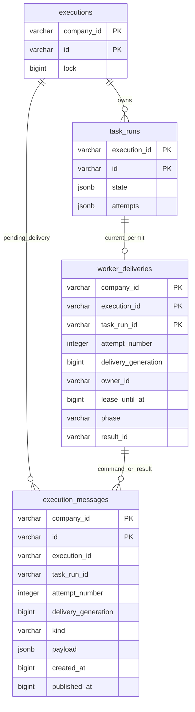
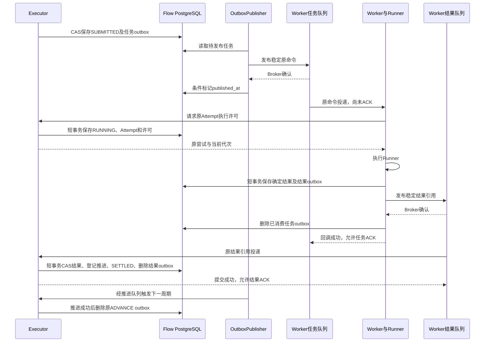

# ADR 0113：Worker 任务提交、结果交接与消费后清理 Outbox

## 状态

Accepted（2026-10-12）。用户确认独立 Worker 任务与结果队列、领取后 RUNNING、消费完成清理 outbox，并要求先跑通完整业务。本记录调整 ADR 0109/0112 的“投递前 RUNNING”及长期保留结果发布记录条款；实际运行证据另存测试报告。

## 背景与选项

同步调用在 RUNNING 已保存后崩溃，推进事件重投仍不能接续原任务。备选为继续同步调用、仅增加结果队列、或持久任务/结果双队列。采用双队列与同事务 outbox，以原实例、精确版本、节点和业务尝试接续。SUBMITTED 表达已提交可靠投递、尚未领取确认；发布标记单独表达 Broker 接收，避免数据库与 Broker 双写窗口。

## 决策

TaskRun 的可执行任务路径为 CREATED → SUBMITTED → RUNNING → 业务结果。Execution 根不进入 SUBMITTED；编排任务仍直接 RUNNING。实际 Attempt 开始时间在 Worker 领取确认时产生。Executor 是唯一业务状态写入者，Worker 经 Executor 开始确认入口领取许可后调用 Runner；调用期间不持有数据库事务。

任务命令、结果及内部推进 outbox 保存在 execution_messages；当前执行许可保存在 worker_deliveries。许可保留当前尝试、代次、owner、租约和已接纳结果身份，供 outbox 清理后的重复/迟到消息识别，不作为永久消息日志。所有 CRUD 经 FlowDataSourceEngine；适配器继承 BaseRepository，聚合 CAS 组合 CasEnhancer。短技术事务只包住许可、CAS、outbox 操作，不跨 Runner 或 Broker。

图中是逻辑关系，数据库不新增外键或业务 CHECK。结果正文只在消费前与消息一同保存，消费后转入原 Attempt / TaskRun 输出；结果处理身份在当前许可保留。运行事实与待发送消息分离，不复制整份流程定义进入队列，Worker从精确已发布版本恢复任务。

## 保存、ACK 与删除

1. 同一次保存将 TaskRun 置 SUBMITTED，并写任务命令 outbox；提交后 ACK 原推进输入。发布器收到 Broker 确认只标记 published_at，不删除。
2. Worker 消费命令，Executor 核验当前节点、尝试、取消和许可；短事务登记 owner/租约并将 SUBMITTED 置 RUNNING、开始 Attempt。Runner 调用不在事务中。
3. Worker 原子保存结果及结果 outbox；结果获 Broker 确认后，消费处理完成并删除对应命令 outbox，返回允许 ACK。已存结果的命令重投只补发结果，不能再次调用 Runner。
4. Executor 接纳结果，在同一次 CAS/短技术事务中保存 Attempt/TaskRun 状态、接纳身份及后续推进 outbox，并删除消费掉的结果 outbox。提交后 ACK 结果。推进 outbox 在对应推进成功后删除。
5. 发布器的条件更新不能将已消费删除的行重新插入。删除与 Broker ACK 无共同事务；ACK 前退出的重复消息依据当前许可、Attempt与聚合状态确认，不依赖永久 inbox。业务重试继续原延迟 outbox，消费或取消失效后删除对应计划。

## 重投与接管

未领取命令沿用原身份；已有结果优先补发。活跃 owner 的重复命令不执行，失联后仅在许可条件满足时接管原 Attempt，并增加技术投递代次，拒绝旧 owner 的续租或结果。接管不制造 FAILED，也不消耗业务重试次数。任务命令重投沿用原 ID 与业务尝试编号，接管代次从当前许可恢复；并不生成新的业务 Attempt。
`RunnableTask.canReplay()` 默认为 false，只有实现保证同一 Execution / TaskRun 调用安全时才可显式开启。
已持久化的结果优先补发；租约过期且尚无结果时才允许安全重放。外部效果不确定仍需任务幂等/对账能力，队列 ACK 不提供外部操作恰好一次保证。

结果首次发布也须等待持久订阅就绪，避免 Broker 首次创建订阅之前消息已被标记发布。关闭 Worker 或结果接纳的测试配置分别为 `flow.worker.enabled=false`、`flow.executor.worker-result.enabled=false`。
租约默认 10000ms，运行中每 1s 续租；租约丢失后的旧 owner 不能保存结果。

取消关闭未完成节点时同时清除待确认输出，覆盖 Pause 已恢复但尚未完成的窗口；已结束节点不再关闭，保留其输出和历史。迟到 Worker 结果仍按聚合当前状态与许可处理，不能恢复已取消节点。

## 理由与影响

消息事实只保留到消费闭合，满足用户清理要求；业务状态、输出、Attempt与有限执行许可继续提供重投判定。开发期基线人工重建并重新生成 JOOQ，不增加运行时 DDL 或兼容历史缺失许可。验证覆盖 SUBMITTED 查询、独立任务与结果队列、强杀重投、重复/迟到结果、取消、业务重试及最终 outbox 零残留。
