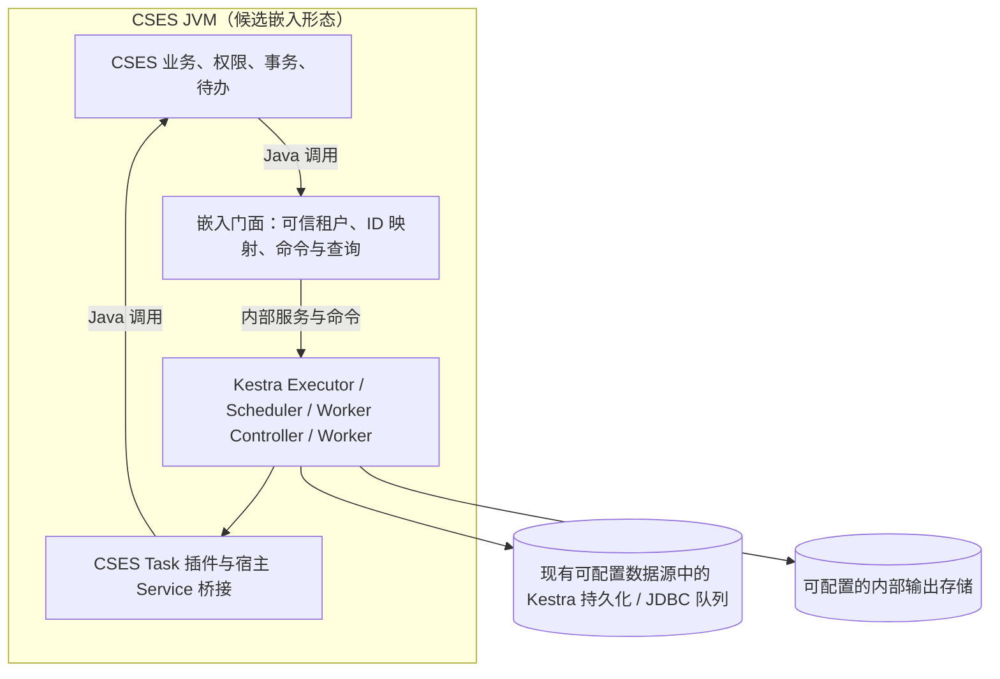

# ADR 0114：评估以 Kestra 作为 CSES 的嵌入式编排底座

## 状态与结论

研究记录（2026-10-12）。后续用户已授权开始迁移，实施决策和进度见 [ADR 0115](0115-migrate-kestra-core-before-business.md)。本文保存研究依据与风险判断，不能当作已完成 Kestra 嵌入 CSES 的证明。

用户已明确：**必须保留嵌入 CSES、同 JVM 直接调用的方式**。独立部署 Kestra 再通过 HTTP SDK 接入不满足本次约束。现有 ADR 0039 还规定单 ApplicationContext、宿主端口与认证共用；这属于当前集成契约，不能仅以“同 JVM 已启动”宣称保持了原集成方式。

结论：Flow 与 Kestra 的通用编排能力高度重叠，人工评估约 **80%–85%**；当前宿主契约不能直接替换。依据用户后续约束，本轮建议采用“先完整迁入 Kestra 核心，再定制 Route 与业务”的顺序：核心持久化和 JDBC 队列接入现有可配置数据源，目标运行链路移除 Pulsar。宿主装配、多租户与会话、精确并行 Pause 恢复、退回派生语义仍需分阶段验收。

百分比只衡量下列功能主题的语义接近程度，不是代码重复率、可直接复用代码比例、迁移完成率或性能测试结果。

## 最新明确约束与分阶段建议

用户于本轮进一步明确以下约束，它们修订前文调研过程中尚可选择的路线：

1. **最终对外的条件分支统一使用自定义 Route**，由 Route 接管 Kestra 的 If/Switch 等条件分支能力；不只是在原生分支旁增加一种可选 Task。
2. **持久化使用现有数据源并支持配置**，不建立另一套固定连接或私有连接池。
3. **队列完全采用 Kestra JDBC 队列，取消 Flow 的 Pulsar 队列**，不保留双队列切换开关作为目标架构。
4. **严格先完成 Kestra 核心的完整迁移与验收，再加入自定义 Route 和业务逻辑**。Scheduler 不能推迟到 Route 阶段；业务差异不能混入原生迁移基线。
5. **完整核心包含扩展机制、Task 导出机制及其配套能力**。插件开发、构建、发现、加载、元数据/Schema/文档导出与运行输出链路均属于第一阶段，不能等业务接入时再补。

### 第一阶段：完整原生核心与宿主基础设施接入

完整性以选定版本的开源引擎及扩展配套能力为准：定义/解析/校验/版本、插件开发与物化、运行模型、Executor、Worker 与 Worker Controller、JDBC 队列、Repository 与状态存储、Scheduler/Trigger、表达式、原生核心 Task、取消/重试/暂停/恢复、插件构建与导出工具、输出/日志及其必要依赖。开始迁移前应建立“能力—上游源码/资源—迁入位置—验证证据”清单，逐项记录迁入、基础设施适配或排除理由；不能用仅复制 `core` 模块代替范围核对。完整核心不等于复制企业版、全部外部插件或整套管理 UI；依赖裁剪必须以完整能力链路核对为依据。

阶段内只允许为嵌入所需的基础设施适配：现有具名数据源、配置、框架依赖对齐、启动/关闭和 Java 调用/导出入口。采用上游原生 Task 和无业务含义的扩展验证插件，不提前引入 Route、审批/待办插件或改变原生 Pause/Replay 语义。验证插件仅用于证明扩展链路，不构成提前实施业务。原生 If/Switch 在迁移基线中保留，作为上游能力和后续 Route 行为对照；这不表示最终产品同时开放两套条件分支。

扩展与导出必须形成以下完整链路：

| 能力 | 第一阶段迁入与验证范围 |
| --- | --- |
| 扩展契约 | Task、RunnableTask、FlowableTask、Trigger、Condition，以及目标 OSS 版本提供的其他扩展接口和所需上下文；完整盘点 TaskRunner、存储、文件渲染等接口，区分接口机制和具体外部插件 |
| 编译期注册 | 插件注解、annotation processor、生成的服务注册资源、插件元数据；验证资源在最终制品中保留，不能只保证 Java 类编译通过 |
| 制品构建与导出 | 插件工程模板、依赖声明、JAR/Shadow JAR 打包、Manifest/资源合并、制品版本及本地发布/安装路径；确保可独立构建插件，不要求修改引擎源码才能新增类型 |
| 发现、加载与类型解析 | 内置及外部插件发现、Registry、ClassLoader、类型标识解析、YAML/JSON 反序列化和配置装配；缺失插件、重复类型与依赖冲突按选定版本行为验证 |
| Task 定义信息导出 | 插件目录、类型、说明、属性、默认值/约束、输入输出结构、示例、图标、JSON Schema、文档，以及目标版本提供的聚合 Schema 资源；按上游实际格式导出，并提供宿主可调用入口 |
| 运行输出 | Task Output、Flow Output 的序列化、数据库/内部存储保存、文件引用、下游表达式读取、查询及重启后读取；与插件制品和定义信息导出分别验收 |
| 配套工具与可观测性 | 定义校验、文档/Schema 生成命令及其后端服务、插件开发测试支撑、日志、指标、错误诊断、产物查询和清理所需能力 |

这里将用户的“Task 导出”按插件制品导出和 Task 定义信息导出两条链路纳入，并另列运行 Output，避免只完成其中一种就宣称全部满足。上游 `PluginProcessor` 实际生成 `META-INF/services/io.kestra.core.models.Plugin`；`PluginScanner` 使用 ServiceLoader 加载；`PluginDocCommand` 可以生成文档并选配 Schema/图标导出。这些分布在 processor、core、cli 等模块，不能按目录名把后两类工具排除出核心迁移。[编译期注册][k-plugin-processor]、[插件发现][k-plugin-scanner]、[文档导出命令][k-plugin-doc-command]、[插件构建说明][k-plugin-build-guide]

本地研究 snapshot 还包含聚合 Schema 导出命令 `PluginsSchemaCommand`。它是否纳入候选稳定版，应按最后锁定的 tag/commit 核对；不混合两个版本的功能来声称“原生完整”。公开资料中的插件功能也需区分 OSS 与 EE，不从开源类名推导出任意插件热卸载、并行多版本运行或所有历史插件二进制兼容的承诺。[本地基线的聚合 Schema 命令][k-plugin-schema-command]

保留上述工具能力后，可由嵌入式 Java 服务、构建任务或小型 CLI 提供入口；无须为了生成 Schema 启动另一套 Kestra Web 服务。具体入口封装属于基础设施适配。CSES 设计器的业务布局和交互在后续实现，但它所依赖的插件元数据、Schema、图标和文档供给必须在第一阶段具备。

数据源接入建议：

- 延续 `datasources.flow.*` 配置入口，连接地址、账号和池参数由 YAML、Consul 或环境变量提供；默认复用现有 `@Named("flow")` DataSource，宿主仍拥有连接池生命周期。
- 将 Kestra 所有引擎持久化、队列、触发状态和运行中任务存储绑定到同一明确选定的数据源。必须覆盖 `DSLContext` 与独立新事务直接取连接的路径，不能只改 Repository 注入而遗漏 Queue/running store；不得回退宿主 `default` 数据源。[JDBC wrapper][k-jdbc]
- 若需要数据源名称也可选，可增加单个选择项并默认 `flow`；这属于待实现的适配配置，不宣称 Kestra 当前已有同名设置。不得重复定义第二套 URL/账号配置。
- **复用数据源不等于强制复用旧 Flow 表结构或 CRUD 实现。** 第一阶段建议保留上游表模型、SQL 和事务语义。把所有 Kestra Repository 改写为 DataSourceEngine 是另一项变化，不从“使用现有数据源”自动推导；若随后要求该实现约束，应单独规划，不能混入原生基线。
- 现有 Flow 与 Kestra 可能使用相同表名。首次验证使用同一配置机制指向隔离验证库；正式目标复用现有选定数据源，表命名空间需明确。可优先评估独立 Schema，但必须核对 SQL、JOOQ 映射、连接 search_path 和迁移脚本的实际支持，不假设增加一个配置项就能完成。
- 沿用宿主当前显式管理建表的约束，准备选定 Kestra 版本的完整建表/升级顺序；不因引入上游而默许应用启动修改现有库。不对当前库执行破坏性操作。
- 文件与大型输出可能使用内部文件/对象存储。数据源复用覆盖数据库持久化，不自动要求把上游全部文件内容改存数据库；输出引用及持久存储位置仍需可配置并验证重启可读。

第一阶段完成标准是：同 JVM 可通过 Java 入口运行完整原生流程，JDBC 队列、Scheduler、输出和恢复都工作，测试运行无需 Pulsar；核心路径切换后清除本项目的 Pulsar 队列实现、注册、依赖及专属配置/测试。清理范围是 Flow 编排链路，不涉及 CSES 其他领域仍使用的 Pulsar。测试应覆盖提交/结果重复、异常消费、JVM 强杀、定时停机恢复和取消竞争；使用真实 PostgreSQL，不以仅编译、内存队列或单个 Log 成功作为核心完整迁移通过。

扩展能力另设第一阶段完成门槛：一个位于引擎源码之外、没有 CSES 业务含义的插件工程，可以独立构建导出制品，经配置加载后出现在插件目录，生成可用 Schema/文档/图标，完成 YAML 定义校验及真实执行，下游可读取它的结构化与文件输出，重启后仍能正确解析持久化定义并读取输出。无图标等可选元数据应按上游契约处理。验证应覆盖编译期资源进入最终 JAR、类型解析失败和至少一种依赖冲突诊断；不能通过手工注册该测试类绕开实际发现路径。RunnableTask、FlowableTask、Trigger 等不同扩展协议分别提供对应证据，不用一个 RunnableTask 的通过替代全部扩展验证。

### 第二阶段：Route 统一条件分支

第一阶段通过后，自定义 Route 接入 `FlowableTask`，在产品定义、插件目录、Schema、示例和发布校验中统一为 Route。原生 If/Switch 可保留在明确隔离的上游源码/参考测试中，但不能继续作为产品公开入口；具体隐藏/拒绝机制必须同时验证，不能只隐藏 UI。[FlowableTask][k-flowable]

Route 的条件求值、子任务选择、未命中 SKIPPED、判断结果保存和重启保持均通过现有 Executor 协议完成，不能在 Task 内手写队列推进。If/Switch 的条件分支目标已经明确，但首个命中、多命中、默认分支等组合规则仍应按已确认 Route/UC 语义逐项映射，不能由移植工作擅自增加。

“统一 Route”限定为流程条件分支任务。trigger.when、启动前 checks、LoopUntil 的继续条件属于各自机制的判断，不因名称含“条件”就改造成 Route；它们可复用表达式设施，并保持原有时机和失败规则。

### 第三阶段：CSES 业务接入与完整兼容验收

Route 完成后再加入可信 companyId/AuthX、宿主业务 Service 调用、业务 Task、精确并行 Pause、退回/待办绑定及相关业务差异。现有已确认用户行为没有因本次迁移方向而被撤销。第一阶段的原生恢复通过不代表这些新增契约已通过，最终仍需相应 UC 验收。

每一阶段形成独立可验收版本，后阶段不得用于掩盖前阶段失败。若存在旧 Flow 在途实例，正式切换前应完成或制定显式迁移方案；最终运行产物不以长期保留 Pulsar 引擎来解决兼容。当前未调查在途实例数量，也未开始任何切换。

## 研究基线

| 对象 | 本轮依据 | 边界 |
| --- | --- | --- |
| Flow | `main`，`0d78cc23998d7b5a6327c62d1e1c580a25741ec0`；开始时工作区干净 | 源码、Accepted ADR、已确认 UC、已有测试报告；本轮未重跑测试 |
| 本地 Kestra | `/System/Volumes/Data/workspace/java/kestra`，`30082712303ebdc8c87d091cf5ac9ff6cc41fe13`，`2.1.0-SNAPSHOT` | 三处用户未提交 Java 修改仅涉及格式/imports/Javadoc，不影响本次语义判断；未修改该仓库 |
| Kestra 稳定版 | 截至研究日核验的 `v2.0.5`，2026-10-05 发布；提交 `172dd0f3760fb1255d3b22bd1fd07ce31b173fa3` | 用于候选二开基线及关键行为交叉核对，不把本地 snapshot 当正式发布版 |
| CSES 接入证据 | 只读检查 `feat-flow` 的 `8f3e93abbf61a05823085f3530673f87e49d04a6` | 当前普通 checkout 是 `feat-doc`，未切分支；该证据不表示生产已部署 |

版本依据：[Kestra v2.0.5 release][k-release]、[固定版本构建属性][k-properties]。官方网站为滚动资料，涉及行为差异时以明确标出的固定源码为准。

Flow 已经不是 ADR 0112 研究时的同步 Worker 状态。当前有 SUBMITTED、独立 Worker 命令与结果队列、租约/投递代次、原子 outbox 及消费后清理，见 [ADR 0113](0113-submit-worker-tasks-and-clean-consumed-outbox.md) 和 [WorkerExecutionCoordinator](../../core/src/main/java/org/cses/flow/executor/WorkerExecutionCoordinator.java)。

[2026-10-12 批量报告](../test-reports/flow/BATCH-2026-10-12-1625.md)记录最终 576 项中 575 PASS、0 FAIL、1 SKIP；UC19 为 14 个场景通过，使用真实 PostgreSQL、Pulsar 和 JVM 强杀。报告明确保留未知外部效果对账、完整 DataPilot 外部生命周期及 Java 21 的覆盖限制。这是已有报告证据，不是本轮新验收；不能据此承诺任意业务副作用 exactly-once。

## 功能相似度与差异

采用八项等权人工分级：4 = 目标及主要模型高度接近；3 = 同类能力、契约或表达不同；2 = 部分对应、关键操作不同；1 = 需要明显定制；0 = 无对应。评分是研究者判断，不是自动检测结果。

| 维度 | 当前 Flow | Kestra 对应 | 分值 |
| --- | --- | --- | --- |
| 定义与版本 | YAML、草稿/正式定义、`companyId + key + version` | YAML、namespace/id/revision | 3/4 |
| 运行领域模型 | Flow、Execution、Task、TaskRun、Attempt、State 历史 | 同类对象及 Executor/Worker 分工 | 4/4 |
| 控制流 | Sequence、Route、Parallel、Loop、LoopUntil、SubFlow | Sequential/If/Switch/Parallel/Loop/LoopUntil/Subflow 等 | 4/4 |
| 输入输出与表达式 | 内置 Input、强类型 Task Output、变量树、受限模板 | Input/Output、运行变量、Pebble 表达式 | 3/4 |
| 触发机制 | Cron、指定日期、上游完成、Webhook | Schedule、ScheduleOnDates、Flow、Webhook 等 | 4/4 |
| 扩展能力 | Java Task/Trigger、编译期插件、定义 Schema | Java Task/Trigger、插件发现与隔离、插件文档/Schema | 3/4 |
| 等待外部结果 | Pause、前置动作、恢复输入、超时 | Pause、onPause/onResume、pauseDuration/timeout | 3/4 |
| 生命周期与重做 | 取消、业务重试、崩溃接续、非终态退回派生 | Kill、Retry、恢复、Restart、Replay | 2/4 |

合计 26/32，约 81%；考虑主题划分和权重的主观性，对外只使用 **80%–85% 的通用能力相似度**。宿主嵌入与租户等硬约束单独判断，不能被高平均分抵消。

Flow 依据：[UC 索引](../uc/flow/README.md)、[扩展源码目录](../../core/src/main/java/org/cses/flow/extensions)、[RunContext](../../core/src/main/java/org/cses/flow/core/runner/RunContext.java)、[模板表达式](../../core/src/main/java/org/cses/flow/core/domains/expressions/TemplateExpression.java)。Kestra 依据：[核心模型][k-models]、[内置插件源码][k-plugins]、[工作流组件][k-components]。

两者的共同业务是“保存定义，触发一次运行，按任务结果推进，等待或重试，并可追溯运行事实”。CSES 的审批单、参与人、待办、业务权限仍由 CSES 持有，现有边界见 [ADR 0038](0038-keep-approval-business-in-cses.md)。采用 Kestra 不会自动提供这些业务模块。

Kestra 的主要增量价值是现成插件生态、表达式能力、管理界面、日志/指标与运维功能；当前 Flow 原生可执行扩展主要为 Log，其余为编排与触发能力。若未来大量连接数据库、脚本、云服务，这些增量价值更大；若近期主要是 CSES 内部业务 Service 的调用与审批等待，受益会更多集中于引擎维护，而关键业务适配仍需自研。[插件开发资料][k-plugin-guide]、[架构资料][k-architecture]

## 决定能否替换的关键契约

### 1. 同 JVM 可运行，不等于现成的宿主嵌入库

Kestra 的 `StandAloneRunner` 可在一个 ApplicationContext/JVM 内启动多个服务角色，包括 Worker Controller；因此“Kestra 完全不能同 JVM”是不准确的。内部 Worker 仍通过 gRPC 通道工作，直接 Java 调用启动命令不代表所有内部交接都成为普通方法调用。[StandAloneRunner][k-standalone]

官方 Java SDK 是 REST API 客户端。所检查源码中可以直接使用内部服务和命令，但本轮没有找到与 Flow 当前公开 Service 等价、承诺支持宿主嵌入的稳定 Java 门面。需要自建边界并承担上游接口变动。[Java SDK][k-sdk]、[ExecutionService][k-service]

实际适配点：

- 生命周期：`KestraContext.Initializer.shutdown()` 会关闭其 ApplicationContext。与 CSES 共用 Context 时必须明确关闭所有权，不能原样接入。[KestraContext][k-context]
- 依赖：Flow 当前 `micronautVersion=5.0.3.51`；Kestra v2.0.5 为 Micronaut `4.10.18`，Java toolchain 25。不能只因两者都是 Java/Micronaut 就推断二进制兼容。[Flow 构建属性](../../gradle.properties)、[Kestra 依赖平台][k-platform]、[Kestra 构建定义][k-build]
- 数据库：Flow 明确使用 `datasources.flow` 和宿主 DataSourceEngine；Kestra 的 JDBC wrapper 注入未限定名的 DSLContext/DataSource，并自有迁移与存储装配。必须隔离数据源、迁移资源和 Bean 选择。[JDBC wrapper][k-jdbc]、[ADR 0111](0111-unify-flow-datasource-and-compose-repository-enhancers.md)
- 插件：Kestra 的插件 ClassLoader 具有 child-first 行为，宿主业务类型不自动获得与 CSES 相同的类身份/Bean 生命周期。插件调用宿主 Service 需要一个明确的 Java 桥接边界。[PluginClassLoader][k-loader]
- Web、安全与配置：不能原样合并两套启动配置、认证和 Controller；应由 CSES 持有入站接口与身份，再调用嵌入门面。此项是基于两项目组合根差异的工程判断，尚未实机证明具体冲突。

同 JVM 下另建 Context 可以研究生命周期隔离，但单靠第二个 Context 不能隔离不同 Micronaut 版本；若再引入独立 ClassLoader，需要解决共享桥接类型、序列化与宿主 Bean 可见性，而且会改变 ADR 0039 的单 Context 方案。不能把这条备选描述成现成兼容方案。

### 2. 并行 Pause 的恢复目标不同

Flow 的正式入口是 `resume(session, executionId, taskRunId, outputs)`；并行节点使用精确 TaskRun 身份，另有 `resumeWhenPaused` 接纳前置动作期间提前到达的结果。[Flow ExecutionService](../../core/src/main/java/org/cses/flow/core/services/executions/ExecutionService.java)

检查到的 Kestra `Resume` 命令没有 `taskRunId`；服务实现通过 `findFirstByState(PAUSED)` 选择暂停节点。它能表达等待外部结果，但该入口不具备 Flow 当前任意指定并行 Pause 的契约。[Resume 命令][k-resume]、[ExecutionService.resume][k-service]

例如 A、B 两个并行待办同时等待，业务上 B 先完成：Flow 能提交 B 的 TaskRun；若直接调用上述 Kestra Resume，则目标由其首个暂停节点决定。适配必须进入命令和状态推进链路，或改变流程建模；仅在 CSES API 增加 `taskRunId` 参数不能解决。

### 3. Flow 退回与 Kestra Replay 不是同一个操作

| 行为 | Flow 既有契约 | Kestra v2.0.5 |
| --- | --- | --- |
| 发起条件 | 运行中的实例到达指定 Pause | 公共 HTTP Replay 入口对普通执行要求终态，playground breakpoint 有例外 |
| 原实例 | 停止旧实例，由新实例接替 | Replay 创建新执行，不是 Flow 的活动实例接替协议 |
| 历史节点身份 | 无关分支继承 TaskRun ID、输出与等待进度 | Replay 重新映射 TaskRun ID，并复制关联输出 |
| 影响范围 | 因果路径、跨嵌套作用域、保留无关并行分支 | 按 Kestra 的 replay 选择与后继清理规则 |
| 宿主先提交 | 只读 planRewind、预分配新 ID、业务事务先保存绑定 | 需要重新构造宿主计划、映射与交接协议 |

依据：[Flow ADR 0087](0087-derive-execution-snapshots-on-replay.md)、[Flow Execution.replay](../../core/src/main/java/org/cses/flow/core/domains/executions/Execution.java)、[Kestra ExecutionService][k-service]、[v2.0.5 HTTP 入口检查][k-replay-controller]、[Replay 官方说明][k-replay]。本地较早 snapshot 与 v2.0.5 的 Replay 前置条件有版本差异。直接 Java 调用可以绕过 HTTP 检查，但这不证明非终态 Replay 具备停止旧实例、保留无关分支身份与安全接替的完整行为。

预分配 Execution ID 并非完全无对应：所检本地 Kestra 内部 `Create` 命令与创建服务有沿用提供 ID 的路径。这部分适配可行，但并不自动补齐 Pause、退回和双聚合原子交接。`ExecutionService.create` 本身只构造运行对象，不能直接当作已经完成持久化和可靠投递的宿主启动入口。[Create 命令][k-create]、[创建与命令发送][k-local-service]

### 4. CSES 多租户不能直接换成 namespace

Flow 的领域对象、Repository 查询、执行命令和 Worker 交接均带 companyId；Session 来自可信宿主上下文。CSES `feat-flow` 的 `CreateTodoTask` 会读取 Flow companyId 构造系统会话，再直接调用 TodoService，ApprovalService/TodoService 则直接依赖 Flow ExecutionService。

这意味着要迁移的是整条“业务身份 → 编排实例 → 异步任务 → 宿主调用”的关联，不只是登录页面。源码入口：[BaseDomain](../../core/src/main/java/org/cses/flow/core/domains/BaseDomain.java)、[FlowQueryHandler](../../core/src/main/java/org/cses/flow/core/services/flows/queries/FlowQueryHandler.java)、[WorkerCommand](../../core/src/main/java/org/cses/flow/worker/WorkerCommand.java)。CSES 的上述类按研究基线分支只读检查，不能使用当前 feat-doc checkout 的缺失作为尚未实现的证据。

Kestra 产品中的多租户、RBAC、SSO 属于 Enterprise 功能。OSS 源码出现 tenantId 字段不等于开源发行版提供多租户产品契约，namespace 也不是自动成立的安全边界。使用 CSES 自有认证并不免除编排查询、输出存储、触发器、子流程、异步消息和插件访问的租户隔离适配。[OSS 与 EE][k-editions]、[TenantService][k-tenant]

### 5. 恢复机制目标相近，尝试历史与副作用契约不同

Flow 当前将业务 Attempt 与 deliveryGeneration 分开；租约过期后只允许声明 `canReplay=true` 的任务按原 Attempt 接管，默认拒绝未知外部效果下自动重放。Kestra 的失联重交付会记录 RESUBMITTED，并在再次运行时形成后续 Attempt。两者不能直接对齐重试次数、审计历史和业务幂等键。[Flow RunnableTask](../../core/src/main/java/org/cses/flow/core/domains/tasks/RunnableTask.java)、[Flow WorkerExecutionCoordinator](../../core/src/main/java/org/cses/flow/executor/WorkerExecutionCoordinator.java)、[Kestra TaskRun][k-taskrun]、[ADR 0112 的固定源码研究](0112-study-kestra-state-persistence-and-recovery.md)

Kestra 2.x 的当前专门 HA 文档明确同时标注 OSS/EE，不能沿用“开源版无高可用”的旧结论。OSS/EE 总览中的概括容易造成不同理解，应以专门文档和固定源码核对；本轮没有进行 Kestra 多节点故障验收。同 JVM 嵌入仍共享 CSES 进程故障域，产品支持分布式 HA 不等于该部署形态天然拥有它。[HA 专门文档][k-ha]

## 二次开发路线与代价

| 方案 | 是否满足本次硬约束 | 判断 |
| --- | --- | --- |
| 独立 Kestra + Java HTTP SDK | 否 | 不作为本次推荐 |
| 保留 Flow，借鉴 Kestra 机制 | 是 | 现有业务契约风险最小；引擎维护继续自负 |
| Kestra 原生内核 + CSES 嵌入门面/业务插件 | 候选，需验证 | 最有可能保留上游收益；优先验证这条路线 |
| 深度 fork，将模型、持久化、队列、Pause/Rewind 全改成 Flow | 可做但代价高 | 可能同时承担自研状态机与上游合并成本；不因 80% 功能相似就选择 |

若进入验证，候选结构如下；图表示建议，不表示已经实现：

按最新约束采用 Kestra 原生数据模型、JDBC 队列及插件协议，数据库连接复用现有可配置数据源，Pulsar 从 Flow 新运行链路移除。CSES 继续拥有业务数据；是否还要求上游 Repository 全部改写为 DataSourceEngine，不能从复用数据源自动推导。

改造成本按责任链路判断，而非虚构人日：

| 链路 | 相对工作量 | 原因 |
| --- | --- | --- |
| 普通 Java 业务 Task、输入输出映射 | 中 | 能利用插件契约，但宿主服务桥接需验证 |
| YAML/版本转换与设计器适配 | 中 | key/id、版本、类型地址、表达式、变量语义不同；不能只替换包名 |
| 同 Context 嵌入、生命周期与依赖统一 | 高且不确定 | Micronaut 版本、数据源/迁移、安全与启动所有权 |
| 租户、AuthX、输出与事件隔离 | 高 | 跨多个读写与异步入口，不能由单个 namespace 约定替代 |
| 精确 Pause、提前回调、退回与历史身份 | 高 | 触及命令、Execution 状态推进及宿主业务绑定 |
| 在途实例迁移 | 高 | 身份、尝试、输出与队列结构不同，没有现成互换格式 |

若存在旧执行，切换前应完成或明确迁移其状态和业务引用。当前是否已有必须保留的生产实例、数量和数据量未调查；最终架构按最新要求不保留 Pulsar 双引擎运行方案。

## 建议决策与验证门槛

### 补充：整体迁入内核、队列、调度和条件

2026-10-12 用户提出迁入 Kestra 的 Flow 定义、队列、定时任务和条件等核心能力。本节保留迁入边界说明；后续源码移植按 ADR 0115 进行，不表示用户已放弃现有 Pause、退回和租户契约。

在接受采用 Kestra 原生运行模型及基础设施的前提下，优先考虑维护一个 **基于固定 Kestra 开源版本的 CSES 嵌入式发行版**。保留可追踪的上游源码与提交来源，在明确扩展点实现 Route 和业务 Task；宿主通过少量 Java Interface 使用完整运行能力。与保留 Flow 原生状态机再逐类拼入 Kestra 队列相比，这条路线更容易保持已有运行协议的一致性。它仍需要实际嵌入验收，不能从同用 Micronaut 推断可直接装配。

| 迁入范围 | 建议包含的配套能力 | CSES 定制位置 |
| --- | --- | --- |
| 定义 | Flow/Task/Input/Output、YAML 解析、校验、版本引用、插件反序列化 | 业务设计器及定义生成/转换；自定义 Route 类型 |
| 运行内核 | Execution/TaskRun/Attempt/State、Executor、Worker、Worker Controller、命令/结果消息、重试/取消/失联恢复 | 精确 Pause/退回等必需差异的集中补丁 |
| 队列 | queue + queue-jdbc、Dispatch/Broadcast、序列化、routing/key、轮询、消费事务与异常策略、表及索引 | 宿主生命周期、数据源与配置适配 |
| 持久化 | jdbc + PostgreSQL 实现、Execution/Flow/Trigger/服务状态与运行中任务存储、输出存储协议 | 现有可配置数据源、引擎表命名空间与后续可信租户接入 |
| 定时调度 | Scheduler、TriggerStateStore、触发事件、分区/归属、Cron/日期触发、漏触发恢复、禁用/更新与运行发布 | 业务触发器、宿主配置与生命周期 |
| 条件 | RunContext 变量与表达式求值；分支、trigger.when、启动前 checks 各自的规则 | Route 的路由规则及必要的旧语法转换 |
| 扩展与制品导出 | 扩展契约、processor/注册资源、插件模板与打包、安装/发现/加载、类型解析和配置 | 宿主业务 Task、Service 桥接；Route 使用已验收的扩展机制 |
| 元数据与工具 | Task 定义信息、插件目录、Schema/文档/图标/示例导出、校验与构建工具 | 宿主 Java 查询/导出入口；后续业务设计器消费这些信息 |
| 输出与观测 | Task/Flow 输出持久化、文件/内部存储、引用与读取、日志/指标、查询及清理 | 宿主存储配置与业务查询视图 |

这是能力闭包，不是保证只需这些 Gradle 模块即可启动的精确依赖清单。首次装配需沿生产路径确认 processor、生成代码、内部存储和日志等依赖；先跑通上游生产与扩展开发闭环，再裁剪完整管理 UI、无关插件及可选后端。CLI 中承担定义校验、插件管理、文档和 Schema 导出的功能必须保留或提供等价入口，不能因它不在 `core` 中就删除。保留源目录不等于必须启动其全部产品角色。2.x 的 Worker Controller/gRPC 是本版本交付协议的一部分，同 JVM 首轮验证宜保持该协议，不能直接删去后仍沿用上游恢复结论。[当前架构][k-architecture]、[Standalone 装配][k-standalone]

**队列按用户最新要求完全采用 Kestra JDBC，连同持久化和运行消费协议一起迁入，取消 Flow Pulsar 队列。** 新运行链路只保留一个推进权威。JDBC 的 dispatch 领取、消费回调、删除队列记录有明确事务顺序，但执行线程切换和后续消息发送并非自动共用一个事务，仍需验证强杀窗口。相关上游边界见 [ADR 0112](0112-study-kestra-state-persistence-and-recovery.md) 和 [JdbcQueueClient][k-jdbc-queue]。目标方案会修订 ADR 0094/0111/0113 的部分实现选择；当前代码尚未切换，后续正式实施决策需明确替代范围。

**Route 保留业务语义，改为 Kestra 的 FlowableTask 扩展。** 所检源码提供 childTasks、resolveNexts、resolveState、outputs、allChildTasks 和拓扑表达等入口。Route 负责解释自有路由条件、选择子任务和表达自身结果；Executor 负责分配/持久化 TaskRun、投递 Worker、推进状态。这样新增路由规则一般可以局部修改 Route，不需要在 Executor 增加业务类型分支。[FlowableTask][k-flowable]、[If 参考实现][k-if]

当前 Flow Route 在未命中时返回 SKIPPED，不创建子任务；它不是把 If 的 then/else 字段改名就能完全替代的。移植应验证未命中事实、嵌套并行、循环内变量、父子身份和退回路径。Kestra If 会保存 evaluationResult 并优先复用，源码也存在输出尚未产生时重新求值的路径；自定义 Route 的条件何时求值、结果如何在重启后保持，需要明确验证，不能仅以“表达式同样为 true”判定等价。[当前 Route](../../core/src/main/java/org/cses/flow/extensions/flow/Route.java)、[If 实现][k-if]

**条件可以共用表达式设施，但保留各层的含义。** Route 判断走哪些子任务；trigger.when 判断这次触发是否成立；checks 用于创建执行前的检查。所检 If 使用渲染后 truthy/falsy 转换，而 checks 的契约要求严格布尔，不能合并成一个无差别 ConditionService。当前 Route 的 `{{ vars.level }} == A` 也不能原样交给 Pebble 当作布尔表达式。若保留既有 DSL，应提供有语法约束的转换/适配并验证比较、缺值和类型规则，不能只拼接字符串。[ConditionService][k-condition-service]、[Check 契约][k-check]、[Checks 文档][k-check-doc]

实施严格按本文开头三阶段顺序：先原生核心（含调度、现有数据源、JDBC 队列、扩展与导出配套）完整验收，再 Route，最后 CSES 业务。此前把 Route 与 Scheduler 接入并列在同一阶段的建议已撤回。

上游源码优先保留原包名和文件归属，CSES 扩展使用自有包；避免首轮就全量改名、重排代码和重写存储接口，以保留小版本修复的可追踪性。这是待采纳的第三方源码维护方案，不是要求当前 Flow 仓库立即改变规范。业务单据、待办、权限、AuthX 和业务事务继续由 CSES 持有。

### 整体采用前的验证门槛

**先完成原生核心迁移验收，再进入 Route 与业务阶段。** 以下是最终替换需满足的完整验证门槛，不能全部算作第一阶段，也不能用第一阶段通过代替最终通过。当前实施和验收状态以 ADR 0115 的迁移台账为准。

验证应产生以下可观察结果，而不止“Kestra 服务启动成功”：

1. CSES 是组合根；Java 方法直接启动、查询、取消一次 Kestra 运行，业务 Task 直接调用真实宿主 Service；启动、停止与配置不会误关宿主或串用业务数据库。
2. 同名 Flow 在两个公司隔离运行；查询、回调、触发器、子流程及输出访问均保持正确租户。
3. A/B 两个并行 Pause 可先提交 B，A 保持等待；重复提交、提前提交、错误节点提交各自符合当前契约。对应既有 UC02、UC04、UC05。
4. 从非终态 Pause 退回历史节点：原实例停止，新实例沿用精确版本，无关并行等待保留身份/进度，旧回调被拒绝，宿主绑定先于新实例回调。对应 UC04、UC10、UC11。
5. 在任务提交、执行中及结果交接阶段强杀 JVM，以真实持久化恢复；区分业务重试和技术重投，检查副作用幂等。对应 UC18、UC19。
6. 将所有为实现以上行为而修改的上游内核位置列清楚，评估一次上游小版本升级的合并范围；不能只算第一轮接入代码量。

若关键能力能由少量扩展点、门面和边界适配完成，采用 Kestra 的收益成立；若必须长期重写其 Resume/Replay、租户、Repository、队列和 Worker 协议，则更合理的选择可能是继续维护现有 Flow。这一判断以验证结果为条件，不预先宣称 Kestra 无法实现。

这些条目复用已确认 UC 的预期，不新增或修改 UC。本轮未运行验证；进入 UC 测试阶段时按仓库约定交由 Test Agent 执行。

## 许可与后果

所检查 Kestra 开源源码采用 Apache-2.0，可按许可进行修改及商业分发；分发时需保留许可、相关版权/归属及适用 NOTICE，并标明修改。许可不自动授予商标权，也不包含 Enterprise 代码和商业权益。第三方插件及依赖应按实际选用制品核对各自许可。[固定源码 LICENSE][k-license]

采用嵌入 fork 会把上游升级兼容、宿主框架升级和业务恢复契约的维护责任交给本团队。采购 EE 可能减少产品级租户/认证开发，但不会自动消除同 JVM 嵌入、精确 Pause 或退回语义差异；本轮未获取商业报价或嵌入/OEM 授权条件。

## 主要官方来源

[k-release]: https://github.com/kestra-io/kestra/releases/tag/v2.0.5
[k-properties]: https://github.com/kestra-io/kestra/blob/172dd0f3760fb1255d3b22bd1fd07ce31b173fa3/gradle.properties
[k-build]: https://github.com/kestra-io/kestra/blob/172dd0f3760fb1255d3b22bd1fd07ce31b173fa3/build.gradle
[k-platform]: https://github.com/kestra-io/kestra/blob/172dd0f3760fb1255d3b22bd1fd07ce31b173fa3/platform/build.gradle#L35
[k-models]: https://github.com/kestra-io/kestra/tree/172dd0f3760fb1255d3b22bd1fd07ce31b173fa3/core/src/main/java/io/kestra/core/models
[k-plugins]: https://github.com/kestra-io/kestra/tree/172dd0f3760fb1255d3b22bd1fd07ce31b173fa3/core/src/main/java/io/kestra/plugin/core
[k-components]: https://kestra.io/docs/workflow-components
[k-plugin-guide]: https://kestra.io/docs/plugin-developer-guide/task
[k-architecture]: https://kestra.io/docs/architecture
[k-standalone]: https://github.com/kestra-io/kestra/blob/172dd0f3760fb1255d3b22bd1fd07ce31b173fa3/cli/src/main/java/io/kestra/cli/StandAloneRunner.java
[k-context]: https://github.com/kestra-io/kestra/blob/172dd0f3760fb1255d3b22bd1fd07ce31b173fa3/core/src/main/java/io/kestra/core/contexts/KestraContext.java#L191-L201
[k-jdbc]: https://github.com/kestra-io/kestra/blob/30082712303ebdc8c87d091cf5ac9ff6cc41fe13/jdbc/src/main/java/io/kestra/jdbc/JooqDSLContextWrapper.java#L42-L56
[k-loader]: https://github.com/kestra-io/kestra/blob/172dd0f3760fb1255d3b22bd1fd07ce31b173fa3/core/src/main/java/io/kestra/core/plugins/PluginClassLoader.java#L16-L60
[k-sdk]: https://kestra.io/docs/api-reference/kestra-sdk/java-sdk
[k-resume]: https://github.com/kestra-io/kestra/blob/172dd0f3760fb1255d3b22bd1fd07ce31b173fa3/core/src/main/java/io/kestra/core/executor/command/Resume.java#L12-L50
[k-service]: https://github.com/kestra-io/kestra/blob/172dd0f3760fb1255d3b22bd1fd07ce31b173fa3/core/src/main/java/io/kestra/core/services/ExecutionService.java
[k-create]: https://github.com/kestra-io/kestra/blob/30082712303ebdc8c87d091cf5ac9ff6cc41fe13/core/src/main/java/io/kestra/core/executor/command/Create.java
[k-local-service]: https://github.com/kestra-io/kestra/blob/30082712303ebdc8c87d091cf5ac9ff6cc41fe13/core/src/main/java/io/kestra/core/services/ExecutionService.java
[k-replay-controller]: https://github.com/kestra-io/kestra/blob/172dd0f3760fb1255d3b22bd1fd07ce31b173fa3/webserver/src/main/java/io/kestra/webserver/controllers/api/ExecutionController.java#L1605-L1617
[k-replay]: https://kestra.io/docs/concepts/replay
[k-editions]: https://kestra.io/docs/oss-vs-paid
[k-tenant]: https://github.com/kestra-io/kestra/blob/172dd0f3760fb1255d3b22bd1fd07ce31b173fa3/core/src/main/java/io/kestra/core/tenant/TenantService.java
[k-taskrun]: https://github.com/kestra-io/kestra/blob/30082712303ebdc8c87d091cf5ac9ff6cc41fe13/core/src/main/java/io/kestra/core/models/executions/TaskRun.java#L241-L268
[k-ha]: https://kestra.io/docs/administrator-guide/high-availability
[k-license]: https://github.com/kestra-io/kestra/blob/172dd0f3760fb1255d3b22bd1fd07ce31b173fa3/LICENSE
[k-jdbc-queue]: https://github.com/kestra-io/kestra/blob/30082712303ebdc8c87d091cf5ac9ff6cc41fe13/queue-jdbc/src/main/java/io/kestra/queue/jdbc/client/JdbcQueueClient.java
[k-flowable]: https://github.com/kestra-io/kestra/blob/30082712303ebdc8c87d091cf5ac9ff6cc41fe13/core/src/main/java/io/kestra/core/models/tasks/FlowableTask.java
[k-if]: https://github.com/kestra-io/kestra/blob/30082712303ebdc8c87d091cf5ac9ff6cc41fe13/core/src/main/java/io/kestra/plugin/core/flow/If.java
[k-condition-service]: https://github.com/kestra-io/kestra/blob/30082712303ebdc8c87d091cf5ac9ff6cc41fe13/core/src/main/java/io/kestra/core/services/ConditionService.java
[k-check]: https://github.com/kestra-io/kestra/blob/30082712303ebdc8c87d091cf5ac9ff6cc41fe13/core/src/main/java/io/kestra/core/models/flows/check/Check.java
[k-check-doc]: https://kestra.io/docs/workflow-components/checks
[k-plugin-processor]: https://github.com/kestra-io/kestra/blob/30082712303ebdc8c87d091cf5ac9ff6cc41fe13/processor/src/main/java/io/kestra/core/plugins/processor/PluginProcessor.java
[k-plugin-scanner]: https://github.com/kestra-io/kestra/blob/30082712303ebdc8c87d091cf5ac9ff6cc41fe13/core/src/main/java/io/kestra/core/plugins/PluginScanner.java
[k-plugin-doc-command]: https://github.com/kestra-io/kestra/blob/30082712303ebdc8c87d091cf5ac9ff6cc41fe13/cli/src/main/java/io/kestra/cli/commands/plugins/PluginDocCommand.java
[k-plugin-schema-command]: https://github.com/kestra-io/kestra/blob/30082712303ebdc8c87d091cf5ac9ff6cc41fe13/cli/src/main/java/io/kestra/cli/schema/PluginsSchemaCommand.java
[k-plugin-build-guide]: https://kestra.io/docs/how-to-guides/custom-plugin
