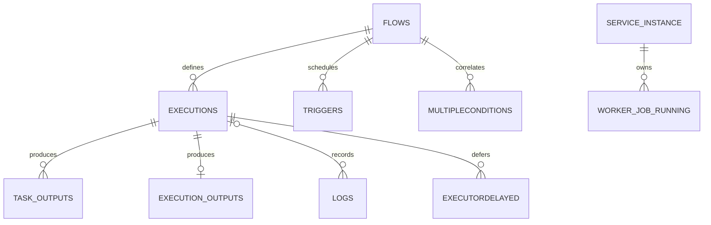

# ADR 0137 显式初始化 PostgreSQL Schema

## 状态

Accepted。修订 ADR 0122、0127、0130 和 0136 中关于增量升级与迁移历史的决定。

## 背景

Flow 作为 Java 引擎嵌入宿主。宿主需要初始化 PostgreSQL 空库。数据库升级和脚本历史不属于当前交付范围。

## 选项

1. 保留版本迁移器并由宿主关闭自动升级。
2. 由宿主显式执行最终建表基线，生产代码、测试和 jOOQ 共同使用一份 SQL。采用。

## 决定

- 核心 schema 包含 13 张表。保留原生列、生成表达式和索引，继续使用现有 jOOQ 映射。
- 基线脚本存放于 core 的 `db/postgres` 资源路径。共享类型和函数先执行，随后创建运行表和日志表。独立日志库使用同一份日志表定义。
- `PostgresSchema.initialize()` 使用具名数据源 `datasources.flow`，由宿主显式调用。DDL 在单个事务内执行，并按 schema 序列化并发初始化。准备 schema 后再调用 `FlowEngine.start()`。
- 移除迁移器、历史表、历史数据转换脚本以及启动升级开关。保留有状态触发器通过宿主存储读写当前游标的路径。

其余表的关联维持现有契约。下图是运行时逻辑关系，SQL 通过现有键和索引提供读写。

`queues` 保存角色间投递，`locks` 保存调度协调锁，`settings` 保存实例元数据。队列载荷及作业标识维持现有 JSONB 表达。

## 理由

一套最终 DDL 可以同时支撑宿主建库、测试和代码生成。应用保持明确的初始化边界，数据库升级由宿主自行决定是否另行处理。

## 后果与验证

空库可以直接初始化。同一份基线可以重复执行，保留现有数据。已有旧版 schema 应由宿主重新选择一个空 schema，旧表与宿主存储对象由宿主管理。验证覆盖 PostgreSQL 空库、重复初始化、独立日志库及引擎回归。
